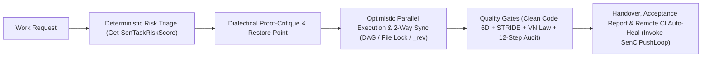

📘 **[Readme](README.md)** | 🖥️ **[Sen-Tổng quan](https://raw.githack.com/developerfs0110/Sen/main/docs/sen-pitch-deck.html)** | 🏢 **[Sen-Office](https://raw.githack.com/developerfs0110/Sen/main/office/index.html)** | 🌐 **English**

# Sen

[](https://github.com/developerfs0110/Sen/actions/workflows/ci.yml)

*"Calm, clear AI work."*

## What Sen Is

**Sen (`sen-method` `v0.4.0`)** is a structured methodology and multi-harness AI engineering operating system (**Google Antigravity IDE**, **Claude Code**, **Cursor**, **GitHub Copilot**, **Windsurf**, **Codex CLI / OpenCode**) combining an **ultra-lean core rule (`<= 5.95 KB`)** with a **deterministic PowerShell runtime (`73` exported cmdlets, `10` `sen-*` skills, `0` external dependencies)**. Every work request is automatically scored (`Get-SenTaskRiskScore`) and classified into 3 tiers so the AI knows when to act immediately, when to run optimistic parallel execution with dialectical proof & critique, and when to design, plan, and coordinate specialist roles. You stay in complete control of progress, code health, legal compliance, and token usage in plain language without memorizing slash commands.

## Problem Sen Solves

- **Unbalanced control:** AI agents either ask too many questions on trivial tasks or charge ahead unchecked on high-risk architectural work (database drops, auth changes, payment flows).
- **Confirmation bias:** Standard AI assistants defend their first idea without adversarial self-critique, missing edge cases, race conditions, and security flaws.
- **Lack of visibility & task drift:** Users cannot easily tell what the AI is doing, tasks drift between Markdown plans and execution state, or agents claim "done" without running real tests.
- **Wasted tokens & quality/legal blind spots:** Tokens are burned reading dozens of files on cold start; generated files grow beyond AI context limits or violate Vietnamese personal data protection and AI transparency laws (`Law 91/2025/QH15`, `Decree 356/2025/ND-CP`, `AI Law 134/2025/QH15`, `E-Commerce Law 122/2025/QH15`).

## Five Principles

1. **Right level of control:** Small tasks run immediately (`Tier 1`), medium tasks present proof + cost and execute optimistically in parallel (`Tier 2`), large or risky tasks go through design, 7-vector dialectical critique, and planning (`Tier 3` with `HardFloorTier3` protection).
2. **Transparent:** Every task is visible through tier labels, **Resource Cost** tables, Mermaid diagrams, automatic 2-way `[x]` sync, acceptance reports, and the **3D Chibi AI Office (`sen-office`)**.
3. **Evidence before claiming done:** Never claim a task is finished without real test evidence (`ExitCode = 0`), passing the 6D Clean Code gate (`100/100`), the Vietnam Legal-by-Design gate, and the 12-step process compliance engine (`Test-SenDeliveryGate`).
4. **Lean by default:** Cold-Start 1-File (`docs/CONTEXT.md` only), core rule under `5.95 KB`, right-sized models (`flash_lite`/`flash` for Scouts, `pro`/`inherit` for Architect/Security), and zero-token hook telemetry.
5. **Compound over time:** Capture execution lessons in 3-Layer Memory (`Add-SenExecutionLesson`) and package recurring workflows into reusable skills (`sen-skill-capture`) so future work gets faster.

## How Sen Works



| Tier | Label | Criteria | How Sen's "Present First — Execute Immediately — Report Result" Works |
|---|---|---|---|
| **Tier 1** | `[Tier 1 - Doing it now]` | UI/CSS fix, content change, bug with known cause, small refactor in 1–2 files, no data-flow change | **AI executes immediately**, runs self-checks (lint/test/build if present), and reports the result. **You do not need to approve intermediate steps.** |
| **Tier 2** | `[Tier 2 - Confirming the approach]` | New feature, logic change touching 3+ files, new library, shared component/API change | AI presents **Objective *Best-of-the-Best* Proof + Adversarial Critique + Resource Cost Table**, takes a restore point (`New-SenRestorePoint`), **executes immediately in parallel** while you read, passes quality gates, and reports with instant 1-touch undo (`Restore-SenRestorePoint`). |
| **Tier 3** | `[Tier 3 - Design & plan]` | New project, architecture change, database, authentication, payments, or any risk of data loss (`HardFloorTier3`) | AI writes **Design Spec (`brainstorming`) + Phase 1 Output Simulation (`Write-SenOfficeShowcase`) + 7-Vector Dialectical Critique (`Invoke-SenDialecticalAudit`) + Implementation Plan (`writing-plans`)**, takes a restore point, coordinates Task DAG / `allowedPaths` file locks / per-task OCC (`_rev`), syncs `[x]` two-way, updates **Phase 2 Output Simulation**, and verifies all 12 process steps. |

*(Pure information and lookup questions are answered directly with no tier label — while destructive prompts disguised as questions are still safely caught at Tier 3.)*

### 8 Empirically Verified Engineering Pillars (`v0.4.0`)

1. **Dialectical "Thesis — Antithesis — Synthesis" Loop (`Invoke-SenDialecticalAudit`):** Proves why the chosen approach is *Best-of-the-Best* with a quantified **Resource Cost** column (Tokens, Time, CPU/RAM/Disk, Maintenance), attacks its own proposal across 7 adversarial vectors (Counterexamples, Boundary Value Analysis, Socratic Contradictions, Popperian Falsification, Decision Tables, Concurrency, STRIDE), and synthesizes an non-falsifiable solution before execution.
2. **Task DAG, File Locks, Optimistic Concurrency Control & 3-Signal Liveness Probe (`Sen.Orchestrator.psm1`):** Tracks tasks in `.agents/office/tasks.json`, auto-promotes tasks when dependencies complete, enforces `allowedPaths` mutual exclusion, prevents lost updates via per-task `_rev` versioning, recovers stuck locks via `Unlock-SenTask`, and runs a 3-signal liveness probe & selective teardown (`Test-SenHungTasks` & `Clear-SenHungTasks`: protecting active long-running tasks via heartbeat/file activity/running subagent in `ActiveLongRunningIds`, catching interactive stdin deadlocks immediately in `DeadlockedItems`, and selectively cleaning up `StaleTaskIds` and `IdleSubagents`).
3. **Zero-Token 2-Way Auto-Sync, 3-Tier Process Compliance & Logic <-> Documentation Parity (`Sen.Harness.psm1`):** Automatically imports all `docs/superpowers/plans/*.md` (supporting both sequential and parallel tasks) and `docs/TODO.md` into `tasks.json` on save (`Sync-SenPlanToTasks`), auto-ticks `[x]` back into Markdown on completion (`Sync-SenTasksToMarkdown`), enforces 12 session-scoped process steps with `SessionStartedAtUtc` timestamp verification (`Test-SenStageGate` / `Test-SenProjectCompliance`), and locks 5-layer Logic <-> Documentation parity (`README_SYNC`, `VERSION_DOC_SYNC`, `TODO_CONTEXT_SYNC` in `Test-SenCapabilityParity`).
4. **6-Dimension Clean Code Gate (`Measure-SenCodeHealth`):** Enforces AI-Native file limits (`<= 800 lines / 45 KB` for logic, `<= 1500 lines` for UI), function length (`<= 100 lines`), nesting depth (`<= 4`), empty `catch {}` blocks, dead functions, and both cross-file and intra-file duplicate blocks per **ISO/IEC 5055 + SonarQube + PSScriptAnalyzer/ESLint**.
5. **Native Vietnam Legal-by-Design Scanner (`Invoke-SenVnLawScan`):** Scans 12 signal categories for **2025–2026 Vietnamese laws** (`PDPL Law 91/2025/QH15`, `Decree 356/2025/ND-CP`, `E-Commerce Law 122/2025/QH15`, `AI Law 134/2025/QH15`): catches un-gated tracking preloads (including multiline `<script>` tags), detects Bot/Backend personal data & receipt forwarding without separate consent (`BOT_DATA_FORWARDING_WITHOUT_CONSENT`), enforces mobile `ACCOUNT_DELETE`, checks AI transparency labels, and flags expired citations (`ND 13/2023`, `ND 52/2013`, `ND 85/2021`).
6. **STRIDE PreToolUse Hook Shield (`guard.ps1` / `guard.sh`):** Blocks 19 categories of destructive shell/git/IEX commands regardless of flag order, protects governance files (`tasks.json`, `process-audit.json`, `loops.json`, `guard.ps1`) from direct tampering, redacts secrets (`Protect-SenRedactedText`), and breaks 3-strike stuck loops (`Test-SenStuckLoop`).
7. **6-Harness Universal Adapter (`Install-SenHarness`):** Projects rules and security hooks (`SupportsHooks = $true`) non-destructively across **Antigravity**, **Claude Code**, **Cursor**, **GitHub Copilot**, **Windsurf**, and **Codex CLI / OpenCode**.
8. **Bounded Remote CI Auto-Heal Loop (`Invoke-SenCiPushLoop`):** Runs local gates $\rightarrow$ commits & pushes $\rightarrow$ polls GitHub Actions CI (`Get-SenRemoteCiStatus`) $\rightarrow$ extracts failed steps, heals, re-tests, and re-pushes (up to 3 attempts) until CI is 100% green.

<!-- office screenshot: added with sen-office -->

🏢 **3D Chibi AI Office (`sen-office` `v0.4.0` built-in):** Say `"open office"` anytime to launch the 3D isometric command center featuring 9 Chibi AI roles + Boss on the red velvet sofa, zero-token hook telemetry (`Eco mode`), 6-counter Inspector Drawer, Replay Scrubber, live `state.vscdb` quota reader, and **Dual-Phase Output Visualizer** (Design Blueprint vs. Verified Delivery). Open **[Sen Office](https://raw.githack.com/developerfs0110/Sen/main/office/index.html)** directly to preview.

## Quick Start

1. **Open Antigravity IDE (or Claude Code / Cursor / Copilot / Windsurf / Codex):** Launch your preferred AI IDE or CLI.
2. **Paste this one-line prompt into the AI chat:**
   ```text
   Please read https://github.com/developerfs0110/Sen/blob/main/INSTALL.md and install Sen for me.
   ```
3. **Follow the guided setup:** Pick a drive for your workspace, answer 4 quick questions to create your `profile.md`, and type `"onboard me"` to try your first Tier 1 task.

👉 **Complete Documentation & Interactive Presentation Hub:**
- 🖥️ **[Sen-Tổng quan](https://raw.githack.com/developerfs0110/Sen/main/docs/sen-pitch-deck.html)** & 🏢 **[Sen Office](https://raw.githack.com/developerfs0110/Sen/main/office/index.html)**
- 📘 **[Full Beginner Guide](docs/guide.md)**
- 🎓 **[IT Freshman Step-by-Step Capstone Guide](docs/SINH-VIEN-IT-STEP-BY-STEP.md)**
- 📊 **[Executive Showcase & Pitch Script](docs/SEN-SHOWCASE-PITCH.md)**
- 🛡️ **[Formal Verification & Adversarial Red-Team Report](docs/ADVERSARIAL-AUDIT-REPORT.md)** *(`237/237` tests passing across `12` test suites, `73/73` direct export coverage `100%`, `22/22` tasks completed, `0/22` adversarial findings falsified)*

## What Sen Uses

During installation, Sen automatically fetches these open-source packages directly from their original repositories (without copying their code into the Sen repository):

- **[superpowers](https://github.com/obra/superpowers)** — Author: **Jesse Vincent** · License: **MIT License** (required).
- **[security-audit](https://github.com/cloudflare/security-audit-skill)** (`skills/security-audit`) — Author: **Cloudflare** · License: **MIT License** (required).
- **[vn-law-check](https://github.com/mhfed/vn-law-check)** (`plugins/vn-law-check/skills/vn-law-check`) — Author: **Contributors to vn-web-compliance-audit** (`mhfed`) · License: **MIT License** (required, for the Vietnamese legal compliance gate).
- **[vie-agentic-skills](https://github.com/huytran1120/vie-agentic-skills)** (`store-screenshots`, `ffmpeg-skill`, `blender-director`) — Author: **Huy Tran (`huytran1120`)** · License: **MIT License** (optional **Creative Domain Packs**: `Install-SenCreativePack -Pack @("media-image", "media-video", "media-3d")` via Git Sparse-Checkout, auto-probing `imagemagick`/`ffmpeg`/`blender` runtimes and blocking destructive in-place `ffmpeg` overwrites).

## Author & Support

```text
Mr Bòn Bon - tunbh.study@gmail.com
(+84) 793.166.866 - (+84) 96.158.1163
Donate: TPBank - 61.222.666.888
```
