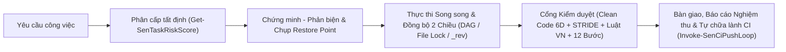

📘 **README (Tiếng Việt)** | 🖥️ **[Tab Slide Thuyết Trình (`sen-pitch-deck.html`)](docs/sen-pitch-deck.html)** | 🎓 **[Cẩm Nang Sinh Viên IT Năm 1 (Step-by-Step)](docs/SINH-VIEN-IT-STEP-BY-STEP.md)** | 📊 **[Tài Liệu Showcase](docs/SEN-SHOWCASE-PITCH.md)** | 🛡️ **[Báo Cáo Phản Biện Red-Team](docs/ADVERSARIAL-AUDIT-REPORT.md)** | 🌐 **[English](README.en.md)**

# Sen

[](https://github.com/developerfs0110/Sen/actions/workflows/ci.yml)

*"Sen: làm việc với đội AI một cách gọn, rõ, nhẹ."*

## Sen là gì

**Sen (`sen-method` `v0.4.0`)** là phương pháp luận và hệ điều hành điều phối đội ngũ AI agent đa nền tảng (**Google Antigravity IDE**, **Claude Code**, **Cursor**, **GitHub Copilot**, **Windsurf**, **Codex CLI / OpenCode**), kết hợp **Luật lõi siêu gọn (`<= 5.75 KB`)** với **Runtime thực thi tất định (`68` cmdlets, `10` kỹ năng `sen-*`, `0` phụ thuộc ngoài)**. Mọi yêu cầu công việc đều tự động được chấm điểm rủi ro (`Get-SenTaskRiskScore`) và phân thành 3 cấp độ để AI biết lúc nào làm ngay, lúc nào thực thi song song lạc quan kèm chứng minh — phản biện, và lúc nào cần thiết kế, lập kế hoạch cùng đội ngũ agent chuyên trách. Bạn luôn nắm quyền kiểm soát tiến độ, chất lượng mã nguồn, pháp lý và chi phí token bằng ngôn ngữ tự nhiên mà không cần học thuộc câu lệnh phức tạp.

## Vấn đề Sen giải quyết

- **Mất cân bằng kiểm soát:** AI hoặc hỏi quá nhiều với việc nhỏ nhặt, hoặc tự ý làm ẩu với việc lớn nhiều rủi ro (như xóa bảng dữ liệu, sửa xác thực, thanh toán).
- **Thiên kiến xác nhận (Confirmation Bias):** AI thông thường chỉ cố khen phương án đầu tiên của nó là đúng mà không tự phản biện, dễ bỏ sót trường hợp biên (Edge Cases), xung đột đồng thời (Race Conditions) và lỗ hổng bảo mật.
- **Thiếu minh bạch & Quên việc:** Người dùng không biết AI đang làm gì, dễ bị trôi việc giữa file kế hoạch Markdown và trạng thái thực tế, hoặc báo cáo "xong" giả tạo khi chưa chạy test thực chất.
- **Lãng phí token & Điểm mù chất lượng/pháp lý:** Token bị đốt vào việc đọc tràn lan hàng chục file ngay đầu phiên; mã nguồn sinh ra phình to vượt ngưỡng đọc của AI, hoặc vi phạm quy định bảo vệ dữ liệu cá nhân & nhãn AI theo pháp luật Việt Nam mới nhất (`Luật 91/2025/QH15`, `NĐ 356/2025/NĐ-CP`, `Luật AI 134/2025/QH15`, `Luật TMĐT 122/2025/QH15`).

## Năm nguyên lý

1. **Đúng mức kiểm soát:** Việc nhỏ tự chạy ngay (`Cấp 1`), việc vừa trình bày chứng minh kèm bảng chi phí rồi làm luôn song song (`Cấp 2`), việc lớn/rủi ro cao có thiết kế, phản biện 7 mũi nhọn và kế hoạch chi tiết (`Cấp 3` với sàn cứng `HardFloorTier3`).
2. **Minh bạch:** Mọi việc đều hiển thị rõ qua nhãn cấp độ, bảng **Tài nguyên tiêu tốn**, sơ đồ Mermaid, đồng bộ 2 chiều tự động (`[x]`), báo cáo nghiệm thu, và **Văn phòng 3D Chibi (`sen-office`)**.
3. **Có bằng chứng mới báo xong:** Không có kết quả kiểm thử thực tế (`ExitCode = 0`), chưa vượt qua cổng Clean Code 6 chiều (`100/100`), cổng Pháp lý Việt Nam và cổng Kiểm toán quy trình 12 bước (`Test-SenDeliveryGate`) thì tuyệt đối không được nói "xong".
4. **Gọn nhẹ mặc định:** Khởi động phiên chỉ đọc 1 file duy nhất (`Cold-Start 1-File` với `docs/CONTEXT.md`), luật lõi luôn dưới `5.75 KB`, dùng đúng model (`flash_lite`/`flash` cho Trinh sát, `pro`/`inherit` cho Kiến trúc/Bảo mật) và ghi nhận sự kiện bằng Hook `0 token`.
5. **Tích lũy:** Lưu bài học thực thi vào bộ nhớ 3 tầng (`Add-SenExecutionLesson`) và đóng gói quy trình lặp lại thành kỹ năng (`sen-skill-capture`) để dự án càng làm lâu càng thông minh hơn.

## Sen hoạt động thế nào



| Cấp độ | Nhãn hiển thị | Khi nào áp dụng | Cơ chế "Trình bày trước — Làm luôn — Báo kết quả" của Sen |
|---|---|---|---|
| **Tier 1 (Cấp 1)** | `[Cấp 1 - Thực thi ngay]` | Sửa giao diện/CSS, đổi nội dung chữ, sửa lỗi đã rõ nguyên nhân, refactor nhỏ trong 1–2 file, không đổi luồng dữ liệu | **AI làm ngay**, tự chạy kiểm tra (lint/test/build nếu có) và báo kết quả. **Bạn không cần chờ duyệt bước phụ.** |
| **Tier 2 (Cấp 2)** | `[Cấp 2 - Xác nhận phương án]` | Thêm tính năng mới, sửa logic chạm từ 3 file trở lên, cài thư viện mới, đổi API/component dùng chung | AI trình bày **Chứng minh *Best-of-the-Best* + Phản biện + Bảng Tài nguyên tiêu tốn**, chụp điểm khôi phục (`New-SenRestorePoint`), **thực thi ngay song song** trong lúc bạn đọc, qua cổng kiểm duyệt và gửi báo cáo nghiệm thu kèm lệnh hoàn tác 1-chạm (`Restore-SenRestorePoint`). |
| **Tier 3 (Cấp 3)** | `[Cấp 3 - Thiết kế & kế hoạch]` | Dự án mới, đổi kiến trúc, đụng cơ sở dữ liệu, xác thực, thanh toán, hoặc có nguy cơ mất dữ liệu (`HardFloorTier3`) | AI viết **Thiết kế (`brainstorming`) + Mô phỏng Output Phase 1 (`Write-SenOfficeShowcase`) + Phản biện 7 mũi nhọn (`Invoke-SenDialecticalAudit`) + Kế hoạch (`writing-plans`)**, chụp điểm khôi phục, điều phối Task DAG / khóa file `allowedPaths` / chống ghi đè tương tranh (`_rev`), đồng bộ `[x]` 2 chiều, cập nhật **Mô phỏng Output Phase 2** và kiểm toán đủ 12 bước trước khi bàn giao. |

*(Câu hỏi tra cứu thông tin thuần túy được AI trả lời thẳng, không gắn nhãn cấp độ — nhưng nếu câu hỏi ẩn chứa lệnh xóa dữ liệu/DB thì Sen vẫn tự động chặn ở Cấp 3.)*

### 8 Trụ cột Kỹ thuật Đã Kiểm chứng Thực nghiệm (`v0.4.0`)

1. **Vòng lặp Biện chứng "Chứng minh — Phản biện — Tối ưu" (`Invoke-SenDialecticalAudit`):** Bắt buộc chứng minh phương án đề xuất là *Best-of-the-Best* kèm cột **Tài nguyên tiêu tốn** (Token, Thời gian, CPU/RAM/Ổ cứng, Bảo trì), sau đó tự đóng vai Nhà phản biện tấn công phương án qua 7 mũi nhọn (Phản ví dụ, Biên BVA, Socratic, Karl Popper, Bảng quyết định, Tương tranh, Bảo mật STRIDE) rồi mới chốt phương án tối ưu không thể bác bỏ.
2. **Điều phối Task DAG, Khóa File & Kiểm soát Tương tranh Lạc quan (`Sen.Orchestrator.psm1`):** Quản lý tiến độ tại `.agents/office/tasks.json`, tự động mở khóa task khi xong phụ thuộc, khóa `allowedPaths` chống 2 Dev sửa đè cùng 1 file, kiểm soát phiên bản `_rev` trên từng Task chống mất dữ liệu đồng thời, và hỗ trợ giải phóng khóa treo qua `Unlock-SenTask`.
3. **Đồng bộ 2 Chiều Tự động 0-Token & Kiểm toán Quy trình 3 Tầng (`Sen.Harness.psm1`):** Tự động nạp mọi file kế hoạch `docs/superpowers/plans/*.md` (hỗ trợ cả task tuần tự lẫn task song song) và `docs/TODO.md` vào `tasks.json` ngay khi lưu file (`Sync-SenPlanToTasks`), tự động tích `[x]` ngược lại Markdown khi hoàn thành (`Sync-SenTasksToMarkdown`), và kiểm toán 12 bước qua 4 giai đoạn (`Test-SenStageGate` / `Test-SenProjectCompliance`).
4. **Cổng Clean Code 6 Chiều (`Measure-SenCodeHealth`):** Tự động quét giới hạn kích thước AI-Native (`<= 800 dòng / 45 KB` cho logic, `<= 1500 dòng` cho UI), hàm quá dài (`> 100 dòng`), lồng ghép quá sâu (`> 4 tầng`), khối `catch {}` rỗng, hàm chết và khối code trùng lặp (cả liên tệp lẫn nội tệp) theo chuẩn **ISO/IEC 5055 + SonarQube + PSScriptAnalyzer/ESLint**.
5. **Pháp lý Việt Nam Nội sinh (`Invoke-SenVnLawScan` — Legal-by-Design):** Quét 11 nhóm tín hiệu mã nguồn theo hệ thống luật Việt Nam mới nhất có hiệu lực **2025–2026** (**Luật Bảo vệ dữ liệu cá nhân `91/2025/QH15`**, **Nghị định `356/2025/NĐ-CP`**, **Luật Thương mại điện tử `122/2025/QH15`**, **Luật Trí tuệ nhân tạo `134/2025/QH15`**): chặn nạp tĩnh script theo dõi trước khi xin phép, bắt buộc luồng xóa tài khoản (`ACCOUNT_DELETE`) trên Mobile App có đăng nhập, yêu cầu nhãn minh bạch AI và chặn dẫn chiếu văn bản hết hiệu lực (`NĐ 13/2023`, `NĐ 52/2013`, `NĐ 85/2021`).
6. **Lá chắn Bảo mật Tầng Hook (`guard.ps1` / `guard.sh`):** Chặn cứng 19 nhóm lệnh hủy dữ liệu/force-push/IEX bất kể vị trí tham số, chống ghi đè trái phép vào các tệp điều phối lõi (`tasks.json`, `process-audit.json`, `loops.json`, `guard.ps1`), tự động che giấu khóa bí mật (`Protect-SenRedactedText`: AWS `AKIA`, GitHub PAT, Google `AIza`, PEM Private Key, JWT, Bearer), và ngắt vòng lặp lỗi 3 lần liên tiếp (`Test-SenStuckLoop`).
7. **Cầu nối Đa Nền tảng 6 IDE/CLI (`Install-SenHarness`):** Giữ `.agents/` làm Nguồn Chân Lý Duy Nhất và đồng bộ cả Luật (Rule) lẫn Lá chắn Hook (`SupportsHooks = $true`) sang cả **6 nền tảng**: Antigravity, Claude Code, Cursor, GitHub Copilot, Windsurf và Codex CLI / OpenCode.
8. **Vòng lặp Tự động Commit/Push & Tự Chữa lành CI Từ xa (`Invoke-SenCiPushLoop`):** Kiểm tra cổng cục bộ $\rightarrow$ commit & push $\rightarrow$ theo dõi GitHub Actions CI từ xa (`Get-SenRemoteCiStatus`) $\rightarrow$ nếu CI đỏ thì tự động bóc tách bước lỗi, sửa lỗi, test lại và push lại (tối đa 3 vòng) cho đến khi CI xanh 100%.

<!-- office screenshot: added with sen-office -->

🏢 **Văn phòng 3D Chibi (`sen-office` `v0.4.0` tích hợp sẵn):** Gõ `"mở văn phòng"` bất kỳ lúc nào để mở sàn 3D trực quan theo dõi 9 nhân vật Chibi AI + Boss trên ghế sofa đỏ, bộ đàm bằng chứng thực thi (`0 token` ở chế độ Tiết kiệm), ngăn kéo 6 ô đếm, thanh tua lại lịch sử, đồng hồ hạn mức trực tiếp từ `state.vscdb` và khung **Đầu ra 2 Giai đoạn** (Đối chiếu Thiết kế vs. Nghiệm thu). Xem trực tiếp tại [`office/index.html`](office/index.html).

## Bắt đầu nhanh

1. **Cài Antigravity IDE (hoặc Claude Code / Cursor / Copilot / Windsurf / Codex):** Mở IDE trên máy của bạn.
2. **Dán một câu cài đặt vào khung chat của AI:**
   ```text
   Hãy đọc https://github.com/developerfs0110/Sen/blob/main/INSTALL.md và cài Sen cho tôi.
   ```
3. **Làm theo hướng dẫn trên màn hình:** Chọn ổ đĩa đặt workspace, trả lời 4 câu ngắn để tạo hồ sơ cá nhân (`profile.md`), rồi gõ `"hướng dẫn tôi"` để trải nghiệm việc Cấp 1 đầu tiên.

👉 **Hệ thống Tài liệu & Trình chiếu Trực quan:**
- 📘 **[Hướng dẫn đầy đủ cho người mới bắt đầu (`docs/huong-dan.md`)](docs/huong-dan.md)**
- 🎓 **[Cẩm nang Sinh viên Năm 1 IT: Giải bài toán khó Step-by-Step (`docs/SINH-VIEN-IT-STEP-BY-STEP.md`)](docs/SINH-VIEN-IT-STEP-BY-STEP.md)**
- 🖥️ **[Slide Thuyết trình Tương tác 3 Tab (`docs/sen-pitch-deck.html`)](docs/sen-pitch-deck.html)** & **[Kịch bản Showcase (`docs/SEN-SHOWCASE-PITCH.md`)](docs/SEN-SHOWCASE-PITCH.md)**
- 🛡️ **[Báo cáo Kiểm chứng Hình thức & Phản biện Đối kháng Red-Team (`docs/ADVERSARIAL-AUDIT-REPORT.md`)](docs/ADVERSARIAL-AUDIT-REPORT.md)** *(Đạt `228/228` tests, `68/68` hàm phủ Unit Test `100%`, `0/22` lỗi sau phản biện)*

## Sen dùng những gì

Khi cài đặt, Sen tự động tải các gói kỹ năng mã nguồn mở uy tín từ kho gốc của tác giả (không sao chép mã nguồn vào repo Sen):

- **[superpowers](https://github.com/obra/superpowers)** — Tác giả: **Jesse Vincent** · Giấy phép: **MIT License** (bắt buộc).
- **[security-audit](https://github.com/cloudflare/security-audit-skill)** (`skills/security-audit`) — Tác giả: **Cloudflare** · Giấy phép: **MIT License** (bắt buộc).
- **[vn-law-check](https://github.com/mhfed/vn-law-check)** (`plugins/vn-law-check/skills/vn-law-check`) — Tác giả: **Contributors to vn-web-compliance-audit** (`mhfed`) · Giấy phép: **MIT License** (tùy chọn, dùng cho cổng kiểm duyệt pháp lý Việt Nam).

## Tác giả & Ủng hộ

```text
Mr Bòn Bon - tunbh.study@gmail.com
(+84) 793.166.866 - (+84) 96.158.1163
Donate: TPBank - 61.222.666.888
```
