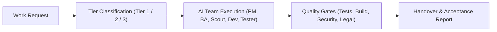

**English** | [Tiếng Việt](README.vi.md)

# Sen

*"Calm, clear AI work."*

## What Sen Is

**Sen** is a structured methodology for working with an AI agent team in Antigravity IDE, packaged as a shareable plugin for any workspace. Every work request is automatically classified into 3 tiers so the AI knows when to act immediately, when to ask once for approval, and when to design, plan, and coordinate specialist roles. You stay in control of progress, quality gates, and token usage in your own language without memorizing slash commands.

## Problem Sen Solves

- **Unbalanced control:** AI agents either ask too many questions on trivial tasks or charge ahead unchecked on high-risk architectural work.
- **Lack of visibility:** Users cannot easily tell what the AI is doing, how far along it is, or whether it actually verified its changes.
- **Wasted tokens:** Tokens are burned reading entire large files, spinning up full agent teams for minor edits, or rambling in long chats.
- **Inconsistent workflows:** Every project is handled ad-hoc with no standard path from initial request through quality gates to final handover.

## Five Principles

1. **Right level of control:** Small tasks run immediately, medium tasks ask once, large or risky tasks go through design and planning.
2. **Transparent:** Every task is visible through tier labels, diagrams, acceptance reports, and the virtual office monitor.
3. **Evidence before claiming done:** Never claim a task is finished without running a real test or verification command.
4. **Lean by default:** Use the right model and minimal tokens, calling a multi-agent team only when genuinely needed.
5. **Compound over time:** Package recurring workflows into reusable skills so future work gets faster.

## How Sen Works



| Tier | Label | Criteria | What the AI Does & What You Do |
|---|---|---|---|
| **Tier 1** | `[Tier 1 - Doing it now]` | UI/CSS fix, content change, bug with known cause, small refactor in 1–2 files, no data-flow change | **AI executes immediately**, runs self-checks (lint/test/build if present), and reports the result. **You do not need to approve intermediate steps.** |
| **Tier 2** | `[Tier 2 - Confirming the approach]` | New feature, logic change touching 3+ files, new library, internal API change | AI summarizes the approach and files to change. **You approve once**, then AI completes the task and delivers an acceptance report. |
| **Tier 3** | `[Tier 3 - Design & plan]` | New project, architecture change, database, authentication, payments, or any risk of data loss | AI clarifies requirements, writes a design with diagrams, and creates a step-by-step plan. **You review the design & plan**, then AI coordinates subagents and runs quality gates. |

*(Pure information and lookup questions are answered directly with no tier label.)*

<!-- office screenshot: added with sen-office -->

## Quick Start

1. **Install Antigravity IDE:** Download and open Antigravity IDE on your computer.
2. **Paste this one-line prompt into the Antigravity chat:**
   ```text
   Please read https://github.com/<owner>/sen-method/blob/main/INSTALL.md and install Sen for me.
   ```
3. **Follow the guided setup:** Pick a drive for your workspace, answer 4 quick questions to create your `profile.md`, and type `"onboard me"` to try your first Tier 1 task.

👉 For a complete beginner walkthrough, read the **[Full Beginner Guide (`docs/guide.md`)](docs/guide.md)**.

## What Sen Uses

During installation, Sen automatically fetches these open-source packages directly from their original repositories (without copying their code into the Sen repository):

- **[superpowers](https://github.com/obra/superpowers)** — Author: **Jesse Vincent** · License: **MIT License** (required).
- **[security-audit](https://github.com/cloudflare/security-audit-skill)** (`skills/security-audit`) — Author: **Cloudflare** · License: **MIT License** (required).
- **[vn-law-check](https://github.com/mhfed/vn-law-check)** (`plugins/vn-law-check/skills/vn-law-check`) — Author: **Contributors to vn-web-compliance-audit** (`mhfed`) · License: **MIT License** (optional, for the Vietnamese legal compliance gate).

## Author & Support

```text
Mr Bòn Bon - tunbh.study@gmail.com
(+84) 793.166.866 - (+84) 96.158.1163
Donate: TPBank - 61.222.666.888
```
