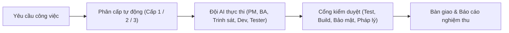

**Tiếng Việt** | [English](README.en.md)

# Sen

[](https://github.com/developerfs0110/Sen/actions/workflows/ci.yml)

*"Sen: làm việc với đội AI một cách gọn, rõ, nhẹ."*

## Sen là gì

**Sen** là một phương pháp luận làm việc với đội AI agent trong Antigravity IDE, được đóng gói thành plugin để bất kỳ ai cũng có thể cài vào workspace của mình. Mọi yêu cầu công việc đều tự động được phân thành 3 cấp độ để AI biết lúc nào làm ngay, lúc nào xin duyệt một lần, và lúc nào cần thiết kế, lập kế hoạch cùng cả đội chuyên trách. Bạn luôn nắm quyền kiểm soát tiến độ, chất lượng và chi phí token bằng chính ngôn ngữ của mình mà không cần học thuộc các câu lệnh phức tạp.

## Vấn đề Sen giải quyết

- **Mất cân bằng kiểm soát:** AI hoặc hỏi quá nhiều với việc nhỏ nhặt, hoặc tự ý làm quá đà với việc lớn nhiều rủi ro.
- **Thiếu minh bạch:** Người dùng không biết AI đang làm gì, đã đến bước nào hay đã kiểm tra kỹ chưa.
- **Lãng phí token:** Token bị tiêu vào những chỗ không cần thiết như đọc toàn bộ file lớn, gọi cả đội agent cho việc nhỏ, hoặc trò chuyện dài dòng lan man.
- **Thiếu quy trình chuẩn:** Mỗi dự án làm một kiểu, không có quy trình thống nhất từ lúc nhận việc, kiểm định chất lượng đến lúc bàn giao.

## Năm nguyên lý

1. **Đúng mức kiểm soát:** Việc nhỏ tự chạy, việc vừa xin duyệt một lần, việc lớn có thiết kế và kế hoạch.
2. **Minh bạch:** Mọi việc đều thấy được qua nhãn cấp độ, sơ đồ, báo cáo, và văn phòng giám sát.
3. **Có bằng chứng mới báo xong:** Không có kết quả test hay kiểm tra thật thì không được nói "xong".
4. **Gọn nhẹ mặc định:** Đúng model, đúng lượng token, chỉ gọi cả đội khi thật sự cần.
5. **Tích lũy:** Việc gì lặp lại thì đóng gói thành skill, để lần sau nhanh hơn.

## Sen hoạt động thế nào



| Cấp độ | Nhãn hiển thị | Khi nào áp dụng | AI làm gì & Bạn làm gì |
|---|---|---|---|
| **Tier 1 (Cấp 1)** | `[Cấp 1 - Thực thi ngay]` | Sửa giao diện/CSS, đổi nội dung chữ, sửa lỗi đã rõ nguyên nhân, refactor nhỏ trong 1–2 file, không đổi luồng dữ liệu | **AI làm ngay**, tự chạy kiểm tra (lint/test/build nếu có) và báo kết quả. **Bạn không cần duyệt bước phụ.** |
| **Tier 2 (Cấp 2)** | `[Cấp 2 - Xác nhận phương án]` | Thêm tính năng mới, sửa logic chạm từ 3 file trở lên, cài thư viện mới, đổi API nội bộ | AI tóm tắt phương án và danh sách file sẽ sửa. **Bạn duyệt một lần**, sau đó AI làm một mạch tới khi hoàn tất và gửi báo cáo nghiệm thu. |
| **Tier 3 (Cấp 3)** | `[Cấp 3 - Thiết kế & kế hoạch]` | Dự án mới, đổi kiến trúc, đụng cơ sở dữ liệu, xác thực, thanh toán, hoặc có nguy cơ mất dữ liệu | AI làm rõ yêu cầu, viết thiết kế kèm sơ đồ, lập kế hoạch chi tiết. **Bạn duyệt thiết kế & kế hoạch**, rồi AI điều phối đội agent thực thi và qua cổng kiểm duyệt. |

*(Câu hỏi tra cứu thông tin thuần túy được AI trả lời thẳng, không gắn nhãn cấp độ.)*

<!-- office screenshot: added with sen-office -->

## Bắt đầu nhanh

1. **Cài Antigravity IDE:** Tải và mở Antigravity IDE trên máy của bạn.
2. **Dán một câu cài đặt vào khung chat của Antigravity:**
   ```text
   Hãy đọc https://github.com/developerfs0110/Sen/blob/main/INSTALL.md và cài Sen cho tôi.
   ```
3. **Làm theo hướng dẫn trên màn hình:** Chọn ổ đĩa đặt workspace, trả lời 4 câu ngắn để tạo hồ sơ cá nhân (`profile.md`), rồi gõ `"hướng dẫn tôi"` để trải nghiệm việc Cấp 1 đầu tiên.

👉 Xem tài liệu chi tiết từng bước cho người mới bắt đầu tại **[Hướng dẫn đầy đủ (`docs/huong-dan.md`)](docs/huong-dan.md)**.

## Sen dùng những gì

Khi cài đặt, Sen tự động tải các gói kỹ năng mã nguồn mở uy tín từ kho gốc của tác giả (không sao chép mã nguồn vào repo Sen):

- **[superpowers](https://github.com/obra/superpowers)** — Tác giả: **Jesse Vincent** · Giấy phép: **MIT License** (bắt buộc).
- **[security-audit](https://github.com/cloudflare/security-audit-skill)** (`skills/security-audit`) — Tác giả: **Cloudflare** · Giấy phép: **MIT License** (bắt buộc).
- **[vn-law-check](https://github.com/mhfed/vn-law-check)** (`plugins/vn-law-check/skills/vn-law-check`) — Tác giả: **Contributors to vn-web-compliance-audit** (`mhfed`) · Giấy phép: **MIT License** (tùy chọn, dùng cho cổng kiểm duyệt pháp lý Việt Nam).

## Tác giả & Ủng hộ

```text
Mr Bòn Bon - tunbh.study@gmail.com
(+84) 793.166.866 - (+84) 96.158.1163
Donate: TPBank - 61.222.666.888
```
