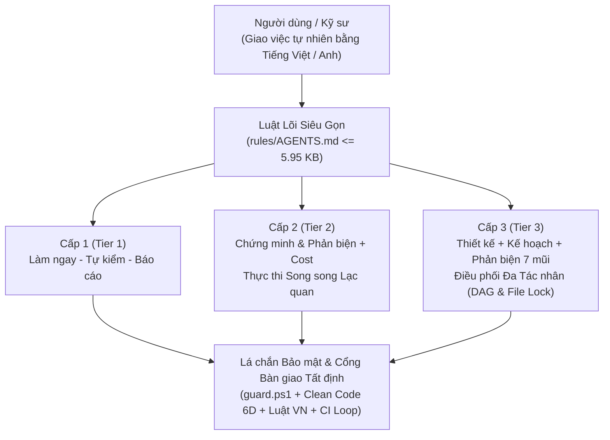
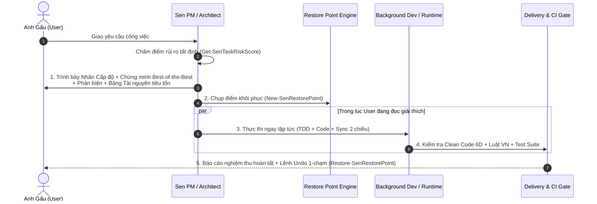
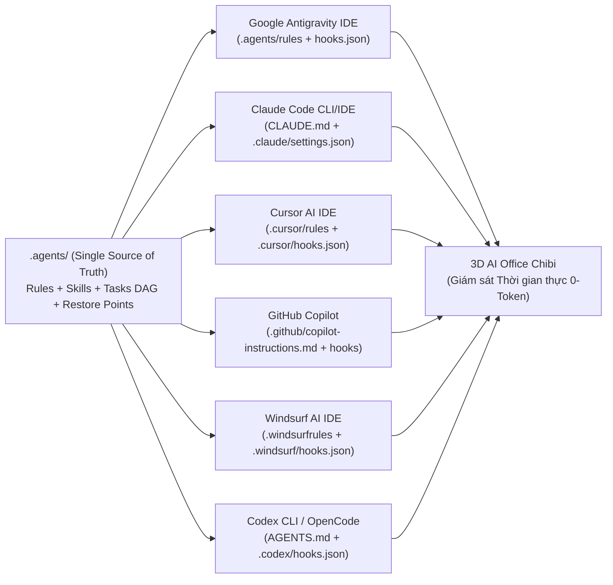
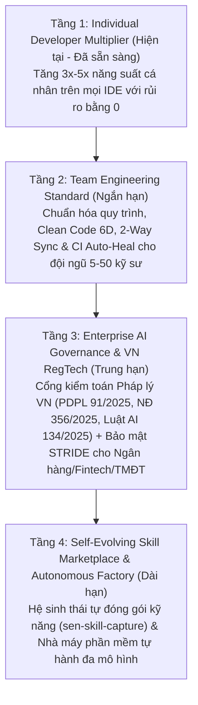

# SEN (`sen-method`) — Tài Liệu Showcase & Kịch Bản Thuyết Trình Toàn Diện

> **"Phức tạp ở bên dưới, giản dị ở bên trên."**  
> **Hệ điều hành Điều phối AI Đa Nền Tảng, Tự Kiểm Toán & Pháp Lý Nội Sinh (Legal-by-Design) dành cho Kỹ sư & Doanh nghiệp.**

- **Phiên bản:** `v0.4.0` (Multi-Harness, Dialectical Hardened & 3D AI Office Edition)
- **Bản trình chiếu tương tác (HTML Slide Deck):** [sen-pitch-deck.html](./sen-pitch-deck.html) *(mở trực tiếp trên trình duyệt, dùng phím `←` / `→` hoặc `Space` để chuyển slide, `F` để bật Fullscreen)*
- **Báo cáo Kiểm chứng & Phản biện Đối kháng:** [ADVERSARIAL-AUDIT-REPORT.md](./ADVERSARIAL-AUDIT-REPORT.md)

---

## Mục Lục Nhanh (Cấu Trúc 10 Slide Thuyết Trình — 15 Phút)

1. **[Slide 1 — Bối cảnh & Nỗi đau (The Problem)](#slide-1--bối-cảnh--nỗi-đau-tại-sao-90-dự-án-dùng-ai-coding-rơi-vào-hỗn-loạn)**
2. **[Slide 2 — Sen là gì? Triết lý Cốt lõi (The Vision)](#slide-2--sen-là-gì-5-nguyên-tắc-vàng-của-hệ-sinh-thái-sen)**
3. **[Slide 3 — Sen đã làm được những gì? (8 Trụ cột Đột phá)](#slide-3--sen-đã-làm-được-những-gì-8-trụ-cột-công-nghệ-đã-hoàn-tất--kiểm-chứng)**
4. **[Slide 4 — Điều phối Thông minh 3 Cấp & Thực thi Song song Lạc quan](#slide-4--phân-tầng-rủi-ro-tất-định--thực-thi-song-song-lạc-quan)**
5. **[Slide 5 — Vòng lặp Biện chứng "Chứng minh — Phản biện — Tối ưu"](#slide-5--đột-phá-tư-duy-vòng-lặp-biện-chứng-chứng-minh--phản-biện--tối-ưu)**
6. **[Slide 6 — Cổng Chất lượng 3 Chiều: Clean Code 6D + Bảo mật STRIDE + Luật Việt Nam](#slide-6--cổng-chất-lượng-3-chiều-clean-code-6d--lá-chắn-bảo-mật--luật-việt-nam-20252026)**
7. **[Slide 7 — 3D AI Office Chibi & Cầu nối Đa Nền Tảng (6 Harnesses)](#slide-7--văn-phòng-ai-3d-trực-quan--cầu-nối-đa-nền-tảng-6-harnesses)**
8. **[Slide 8 — Bằng chứng Thực nghiệm: Kiểm chứng Toán học & Phản biện Đỏ (Red-Team)](#slide-8--bằng-chứng-thực-nghiệm-vượt-qua-kiểm-chứng-hình-thức--phản-biện-đối-kháng)**
9. **[Slide 9 — Tại sao chọn Sen? Bảng So sánh Chuyên gia & Tài nguyên Tiêu tốn](#slide-9--tại-sao-sen-đáng-sử-dụng-so-sánh-với-các-công-cụ-hiện-hành)**
10. **[Slide 10 — Tiềm lực & Lộ trình Tương lai của Sen (The Strategic Potential)](#slide-10--tiềm-lực-của-sen-từ-công-cụ-cá-nhân-đến-nền-tảng-ai-governance-doanh-nghiệp)**

---

## Slide 1 — Bối cảnh & Nỗi đau: Tại sao 90% dự án dùng AI Coding rơi vào hỗn loạn?

### Nội dung trình chiếu (Key Bullets)
Khi sử dụng các AI Agent hiện nay (Antigravity, Claude Code, Cursor, Copilot, Windsurf, Codex) vào dự án thực tế, lập trình viên và doanh nghiệp đối mặt với **5 "căn bệnh kinh niên"**:
1. **Hội chứng "Vừa thừa vừa thiếu" (Over/Under-Engineering):**
   - Việc nhỏ (sửa màu nút bấm) thì AI hỏi 5 bước kế hoạch dài dòng; việc cực kỳ nguy hiểm (xóa bảng DB, đổi kiến trúc phân quyền) thì AI tự ý sửa thẳng làm hỏng hệ thống.
2. **Thiên kiến Xác nhận (Confirmation Bias) & "Báo cáo Xanh giả tạo":**
   - AI luôn tự khen phương án của mình là tốt nhất, bỏ sót trường hợp biên (Edge Cases), xung đột đồng thời (Race Conditions) và tự báo cáo "Đã xong" khi code chưa chạy qua bài test thực chất.
3. **Mất Trạng thái & Quên Việc (Context Rot & Task Drift):**
   - Qua phiên chat mới, AI quên sạch quyết định thiết kế cũ, đọc tràn lan hàng chục file làm tốn Token, bỏ sót task trong bản kế hoạch.
4. **Rủi ro Phá hủy & Bảo mật (Destructive Commands & Secret Leaks):**
   - Một lệnh `rm -rf`, `git push --force`, hoặc lộ khóa `AKIA...` / `github_pat_...` vào log có thể gây thiệt hại không thể cứu vãn.
5. **Điểm mù Pháp lý Việt Nam & Tiêu chuẩn Mã nguồn:**
   - Gắn Google Analytics/Facebook Pixel chạy trước khi người dùng đồng ý, thiếu nút Xóa tài khoản trên Mobile App, hoặc trích dẫn Nghị định đã hết hiệu lực (vi phạm Luật Bảo vệ dữ liệu cá nhân `91/2025/QH15` và `NĐ 356/2025/NĐ-CP`).

> **🎤 Lời dẫn thuyết trình (Speaker Notes):**  
> *"Thưa mọi người, AI viết code ngày nay rất nhanh, nhưng tốc độ mà không có kỷ luật thì chỉ tạo ra rác kỹ thuật nhanh hơn. Chúng ta không thiếu những mô hình AI thông minh — thứ chúng ta thiếu là một **Hệ điều hành Quản trị & Điều phối (Governance & Orchestration Layer)** đủ thông minh để biến một AI tự do thành một đội ngũ kỹ sư chuẩn mực. Đó là lý do **Sen** ra đời."*

---

## Slide 2 — Sen là gì? 5 Nguyên tắc Vàng của Hệ sinh thái Sen

### Nội dung trình chiếu
**Sen (`sen-method`)** không phải là một tập câu lệnh gợi ý (prompt) rời rạc. Sen là một **Hệ thống Điều phối & Kiểm toán Kỹ thuật Phần mềm bằng AI (AI Software Engineering Harness)** vận hành bằng mã thực thi tất định (Deterministic Runtime), tuân thủ **5 nguyên tắc**:



1. **Một cửa duy nhất (Single Entry Point):** Tự động nhận diện ngôn ngữ, phong cách làm việc và công nghệ chủ đạo qua hồ sơ cá nhân hóa.
2. **Tương xứng rủi ro (Risk-Proportional Effort):** Việc nhỏ làm ngay (`Cấp 1`); việc vừa chứng minh phương án tối ưu rồi làm luôn (`Cấp 2`); việc lớn/rủi ro cao có thiết kế, phản biện và kế hoạch bài bản (`Cấp 3`).
3. **An toàn mặc định (Safe by Default):** Chặn cứng lệnh phá hoại ở tầng Hook trước khi chạm tới hệ điều hành; luôn chụp điểm khôi phục (`Restore Point`) trước khi sửa code.
4. **Dựa trên bằng chứng vật lý (Evidence-Based):** Mọi bước trong quy trình và mọi Task chỉ được công nhận hoàn thành khi có bằng chứng kiểm thử thực tế (`ExitCode = 0`) đúng phiên hiện tại (`SessionStartedAtUtc`).
5. **Siêu tiết kiệm Ngữ cảnh (Ultra-Lean Context Budget):** Toàn bộ luật lõi luôn nạp trong phiên chỉ chiếm **`<= 5.95 KB` (`62 dòng`)** — nhường hơn **98% cửa sổ ngữ cảnh** của AI cho bài toán thực tế của dự án.

---

## Slide 3 — Sen đã làm được những gì? (8 Trụ cột Công nghệ Đã Hoàn tất & Kiểm chứng)

Toàn bộ kiến trúc của Sen từ phiên bản `v0.1.0` đến `v0.4.0` (`22/22` tasks hoàn tất từ `TASK-01` $\rightarrow$ `TASK-22`) đã được hiện thực hóa thành **73 hàm cmdlet thực thi (`73/73` phủ Unit Test 100%)**, **10 kỹ năng chuyên sâu (`sen-*`)**, **12 bộ kiểm thử tự động (`237/237` bài test)** và **0 phụ thuộc ngoài**:

| # | Trụ cột Công nghệ | Giải quyết bài toán gì? | Thành phần / Hàm thực thi tiêu biểu |
|---|---|---|---|
| **1** | **Phân tầng Rủi ro Tất định & Cold-Start 1-File** | Chấm điểm rủi ro khách quan; khởi động phiên chat chỉ đọc 1 file duy nhất (`docs/CONTEXT.md`) | `Get-SenTaskRiskScore` trong [Sen.Runtime.psm1](../scripts/Sen.Runtime.psm1) |
| **2** | **Thực thi Song song Lạc quan & Hoàn tác 1-Chạm** | *"Trình bày trước — Làm luôn — Báo kết quả"*: Không bắt người dùng chờ đợi duyệt thủ công; hoàn tác byte-exact tức thì | `New-SenRestorePoint`, `Restore-SenRestorePoint` trong [Sen.Orchestrator.psm1](../scripts/Sen.Orchestrator.psm1) |
| **3** | **Vòng lặp Biện chứng "Chứng minh — Phản biện — Tối ưu"** | Bắt buộc chứng minh phương án là *Best-of-the-Best* kèm bảng **Tài nguyên tiêu tốn**, tự tấn công bằng 7 mũi phản biện trước khi chốt | `Invoke-SenDialecticalAudit` trong [Sen.Harness.psm1](../scripts/Sen.Harness.psm1) |
| **4** | **Điều phối Đa Tác nhân, DAG, OCC `_rev` & Liveness 3 Tín hiệu** | Quản lý trạng thái Task theo DAG, khóa `allowedPaths`, chống mất dữ liệu tương tranh, bảo vệ task chạy lâu (`ActiveLongRunningIds`), bắt kẹt stdin (`DeadlockedItems`) và dọn dẹp chọn lọc (`StaleTaskIds`, `IdleSubagents`) | `New-SenTask`, `Start-SenTask`, `Unlock-SenTask`, `Complete-SenTaskReview`, `Test-SenHungTasks`, `Clear-SenHungTasks` |
| **5** | **Đồng bộ 2 Chiều 0-Token, Kiểm toán Phiên & Đồng bộ 5 Tầng** | Tự động nạp Task từ Plan/TODO vào `tasks.json` và tích `[x]` ngược lại Markdown; kiểm toán 12 bước theo phiên (`SessionStartedAtUtc`); khóa đồng bộ Logic ↔ Tài liệu 5 tầng | `Sync-SenPlanToTasks`, `Sync-SenTasksToMarkdown`, `Test-SenStageGate`, `Test-SenProjectCompliance`, `Test-SenCapabilityParity` |
| **6** | **Lá chắn Bảo mật STRIDE & Chống Lặp Vô hạn** | Chặn 19 nhóm lệnh hủy dữ liệu/force-push/IEX, bảo vệ file cấu hình lõi, che giấu khóa bí mật (AWS, PAT, PEM, JWT), ngắt vòng lặp lỗi 3 lần | [guard.ps1](../scripts/guard.ps1), [guard.sh](../scripts/guard.sh), `Protect-SenRedactedText`, `Test-SenStuckLoop` |
| **7** | **Clean Code 6 Chiều & Pháp lý Việt Nam Nội sinh** | Quét 6 chiều chất lượng mã nguồn (ISO/IEC 5055 + SonarQube + AI-Native 800L) và 12 tín hiệu Luật VN (`Luật 91/2025`, `NĐ 356/2025`, `Luật AI 134/2025` + quét rò rỉ dữ liệu Bot/Backend `BOT_DATA_FORWARDING_WITHOUT_CONSENT`) | `Measure-SenCodeHealth`, `Invoke-SenVnLawScan` trong [Sen.Legal.psm1](../scripts/Sen.Legal.psm1) |
| **8** | **Cầu nối 6 Nền tảng & Văn phòng AI 3D + Tự chữa lành CI** | Chạy đồng nhất trên Antigravity, Claude Code, Cursor, Copilot, Windsurf, Codex; hiển thị 3D AI Office & Mô phỏng Output 2 Giai đoạn *Read-Merge-Write*; tự động sửa lỗi CI từ xa | `Install-SenHarness`, `Write-SenOfficeShowcase`, `Invoke-SenCiPushLoop`, [office/index.html](../office/index.html) |

---

## Slide 4 — Phân tầng Rủi ro Tất định & Thực thi Song song Lạc quan

### Cơ chế vận hành ("Trình bày trước — Làm luôn — Báo kết quả")
Thay vì bắt người dùng đọc kế hoạch rồi ngồi chờ AI thực thi, Sen kết hợp **Tính minh bạch của Chuyên gia** với **Tốc độ Thực thi Tức thì**:



- **Chốt chặn An toàn Không thể Vượt rào:**
  - Nếu câu lệnh có chứa tín hiệu rủi ro cao (**Database, Auth/OAuth, Thanh toán, Xóa dữ liệu, Kiến trúc mới**), hàm `Get-SenTaskRiskScore` áp dụng **Sàn cứng Cấp 3 (`HardFloorTier3 = $true`)** — kể cả khi người dùng nói *"làm luôn đi"* hay ngụy trang dưới dạng câu hỏi kết thúc bằng dấu `?`, Sen vẫn kiên quyết bảo vệ dự án ở Cấp 3.

---

## Slide 5 — Đột phá Tư duy: Vòng lặp Biện chứng "Chứng minh — Phản biện — Tối ưu"

### Tại sao phương pháp này tạo ra sự khác biệt đẳng cấp của Sen?
Hầu hết các AI Agent chỉ làm bước **Chứng minh xuôi (Thesis)** — đưa ra một giải pháp rồi liệt kê ưu điểm của nó. Sen bắt buộc thực thi **Vòng lặp Biện chứng 3 Bước (Dialectical Loop)** ở Cấp 2 và Cấp 3:

1. **Bước 1 — Thesis (Chứng minh Chuyên gia & Chi phí Tài nguyên):**
   - Đưa ra danh sách rút gọn các phương án tốt nhất, chứng minh tại sao phương án đề xuất là *Best-of-the-Best*, và bắt buộc định lượng cột **Tài nguyên tiêu tốn** (*Token, Thời gian thực thi, CPU/RAM/Ổ cứng, Chi phí bảo trì dài hạn*).
2. **Bước 2 — Antithesis (Phản biện Đối kháng 7 Mũi nhọn):**
   - Đóng vai Nhà phản biện Độc lập (Adversarial Reviewer) tự tấn công phương án vừa chọn qua 7 góc độ:
     - *(a)* Tìm phản ví dụ cụ thể;
     - *(b)* Phân tích trường hợp biên & điểm mù (BVA);
     - *(c)* Truy vấn Socratic giữa Lời hứa và Mã thực thi;
     - *(d)* Bác bỏ giả thuyết theo tinh thần Karl Popper (Falsification);
     - *(e)* Phân vùng tương đương & Bảng quyết định tổ hợp;
     - *(f)* Điều kiện tương tranh, Race Condition, Deadlock & Thứ tự sự kiện;
     - *(g)* Mô hình đe dọa bảo mật STRIDE.
3. **Bước 3 — Synthesis (Tổng hợp Phương án Tối ưu $S^*$ & Kiểm toán Tự động):**
   - Nếu phương án ban đầu bị phản biện đánh sập, Sen lập tức tinh chỉnh thành phương án hợp nhất $S^*$ không thể bác bỏ rồi mới thực thi, và xác minh tự động bằng lệnh `Invoke-SenDialecticalAudit`.

---

## Slide 6 — Cổng Chất lượng 3 Chiều: Clean Code 6D + Lá chắn Bảo mật + Luật Việt Nam 2025/2026

Không một dòng code nào được phép bàn giao (`Test-SenDeliveryGate`) nếu chưa vượt qua **3 Cổng Kiểm định Tự động**:

### 1. Clean Code 6 Chiều (`Measure-SenCodeHealth`)
Kết hợp tiêu chuẩn **ISO/IEC 5055**, **SonarQube**, **PSScriptAnalyzer/ESLint** và **Giới hạn Ngữ cảnh AI-Native**:
- Kiểm soát kích thước tệp (`<= 800 dòng / 45 KB` cho tệp logic, `<= 1500 dòng` cho UI) để AI không bao giờ bị "tràn não" khi đọc file.
- Phát hiện hàm quá dài (`> 100 dòng`), lồng ghép điều khiển quá sâu (`> 4 tầng`), khối `catch {}` rỗng nuốt lỗi, hàm chết không gọi tới, và **khối code trùng lặp cả liên tệp lẫn nội tệp**.

### 2. Pháp lý Việt Nam Nội sinh (`Invoke-SenVnLawScan` — Legal-by-Design)
Công cụ đầu tiên tại Việt Nam tích hợp kiểm toán mã nguồn tự động theo hệ thống luật mới nhất có hiệu lực **2025–2026**:
- **Luật Bảo vệ dữ liệu cá nhân `91/2025/QH15` & Nghị định `356/2025/NĐ-CP`:** Tự động phát hiện script theo dõi (`gtag`, `fbq`, `tiktok`, `clarity`) nạp tĩnh trước khi người dùng nhấn đồng ý (`TRACKING_PRELOAD_WITHOUT_CONSENT`), chống lách luật qua thẻ `<script>` nhiều dòng hoặc comment giả mạo; đồng thời phát hiện hành vi Bot/Backend tự động chuyển tiếp ảnh biên lai/dữ liệu cá nhân nhạy cảm sang kênh thứ ba khi chưa tách bạch đồng ý (`BOT_DATA_FORWARDING_WITHOUT_CONSENT` — `TASK-20`).
- **Quy định Kho ứng dụng & Quyền xóa dữ liệu:** Phát hiện ứng dụng Mobile (Flutter, React Native, Expo, iOS, Android) có đăng nhập (`AUTH`) nhưng thiếu luồng xóa tài khoản (`MOBILE_AUTH_MISSING_ACCOUNT_DELETE`).
- **Luật Trí tuệ nhân tạo `134/2025/QH15` & Luật Thương mại điện tử `122/2025/QH15`:** Tự động nhận diện tín hiệu tích hợp AI (`OpenAI`, `Anthropic`, `Gemini`) để yêu cầu nhãn minh bạch AI, và chặn mọi trích dẫn văn bản pháp luật đã hết hiệu lực (`NĐ 13/2023`, `NĐ 52/2013`, `NĐ 85/2021`).

### 3. Lá chắn Bảo mật Tầng Hook (`guard.ps1` / `guard.sh`)
- Chặn cứng các lệnh hủy diệt dữ liệu bất kể thứ tự tham số (`rm /path -rf`, `rm --recursive`, `Get-ChildItem -Recurse | Remove-Item`, `git push origin "+main:main"`, `git clean --force`, `iex (irm ...)`).
- Chống giả mạo (Tampering) trực tiếp vào các tệp điều phối lõi (`tasks.json`, `process-audit.json`, `loops.json`, `guard.ps1`).

---

## Slide 7 — Văn phòng AI 3D Trực quan & Cầu nối Đa Nền Tảng (6 Harnesses)

### 1. Viết một lần — Chạy trên mọi IDE & CLI (`Install-SenHarness`)


- Kỹ sư có thể bắt đầu thiết kế kiến trúc trên **Antigravity**, chuyển sang **Claude Code** hoặc **Cursor** để code, và chạy kiểm thử bằng **Codex CLI** — toàn bộ 6 công cụ cùng đọc chung một trạng thái `.agents/office/tasks.json`, cùng chịu sự bảo vệ của `guard.ps1` thông qua bộ chuẩn hóa đa hình `ConvertFrom-SenHookPayload`.

### 2. Văn phòng AI 3D Chibi (`sen-office`) — Minh bạch hóa Hộp đen AI
- Chuyển hóa toàn bộ hoạt động ngầm của các Agent (PM, BA/Architect, Scout, Frontend Dev, Backend Dev, QA Tester, Security Auditor) thành hình ảnh trực quan trong không gian 3D thời gian thực.
- **Ghi nhận bằng chứng 0-Token (`office-post.ps1`):** Mọi thao tác đọc/ghi/chạy lệnh đều được ghi nhận tự động ở tầng Hook mà không tốn thêm bất kỳ Token nào của mô hình ngôn ngữ.

---

## Slide 8 — Bằng chứng Thực nghiệm: Vượt qua Kiểm chứng Hình thức & Phản biện Đối kháng

> **Điểm khác biệt lớn nhất của Sen:** Chúng tôi không chỉ nói Sen tốt — chúng tôi đã xây dựng một dự án kiểm toán độc lập (`sen-adversarial-bench`) đóng vai **Kẻ tấn công Đỏ (Adversarial Red-Team)** dùng 7 kỹ thuật phản biện khắt khe nhất để tự tấn công Sen, tìm ra **22 điểm mù thực nghiệm**, và **vá triệt để 100%**!

| Hạng mục Kiểm chứng Thực nghiệm | Trước Phản biện (Baseline) | Sau Cải tiến Biện chứng (`v0.4.0`) | Ý nghĩa Thực tiễn |
|---|---|---|---|
| **1. Chứng minh Hình thức 4 Mệnh đề (`1a` – `1d`) & 5-Layer Parity** | `4/4` Claims (`15/15` checks) | **`4/4` Claims (`15/15` checks + `5/5` Parity Layers)** | Đầy đủ quy trình 12 bước đúng phiên (`SessionStartedAtUtc`) & đồng bộ Logic ↔ Tài liệu |
| **2. Độ phủ Unit Test Trực tiếp (`1C-EXPORT-COV`)** | `54/66` hàm (`81.82%`) | **`73/73` hàm (`100.00%`)** | 100% hàm xuất khẩu của Sen đều có Unit Test kiểm chứng trực tiếp |
| **3. Tấn công Phản biện 7 Mũi nhọn (`2a` – `2g`) & 22 Tasks** | `22` lỗ hổng bị xuyên thủng | **`0 / 22` lỗ hổng (`100% Vá kín` | `22/22` Tasks)** | Chặn đứng mọi biến thể lách luật, tương tranh, giả mạo, vượt rào và treo tiến trình |
| **4. Ma trận Bác bỏ Karl Popper (`H1` – `H8`)** | `8/8` giả thuyết bị bác bỏ | **`8 / 8` giả thuyết Vững chắc (`[CORROBORATED]`)** | Các bất biến an toàn đứng vững trước dữ liệu thù địch |
| **5. Bảng Quyết định Tổ hợp (`Probe 2e`)** | `6` tổ hợp bất thường | **`0` bất thường (`Anomalies = 0`)** | Không còn điểm mù tổ hợp giữa Cấp độ (Tier 1–3) và Phạm vi (Core/Web/Mobile) |
| **6. Chỉ số Sức khỏe Mã nguồn (`Measure-SenCodeHealth`)** | `100/100` | **`100 / 100` (`Healthy = True`, 28 tệp)** | Tự thân mã nguồn của Sen đạt chuẩn ISO/IEC 5055 & SonarQube tuyệt đối |
| **7. Bộ Kiểm thử Hồi quy (`tests/run.ps1`)** | `227/227` PASS | **`237 / 237` PASS (`12` Test Suites)** | Cam kết chất lượng bằng bằng chứng thực thi tự động |

---

## Slide 9 — Tại sao Sen đáng sử dụng? So sánh với các Công cụ Hiện hành

### Bảng Thẩm định Khách quan & Tài nguyên Tiêu tốn (Resource Cost Matrix)

| Tiêu chí | Prompt / Rules Tĩnh (`.cursorrules` / `CLAUDE.md` thuần) | Bộ Kỹ năng Quy trình (`Superpowers` / `BMAD` thuần) | Framework Đa Agent Nặng (`CrewAI` / `AutoGen` / `LangGraph`) | **Hệ sinh thái SEN (`sen-method` `v0.4.0`) — *Best-of-the-Best*** |
|---|---|---|---|---|
| **Bản chất kiến trúc** | Văn bản nhắc nhở tĩnh (AI có thể quên hoặc phớt lờ) | Bộ quy trình Markdown tốt nhưng thiếu Runtime kiểm toán & thiếu lá chắn hệ thống | Cần viết code Python riêng, dựng server/DB ngoài IDE | **Luật Lõi Siêu Gọn (`<= 5.95 KB`) + Runtime Thực thi Tất định (`73` cmdlets) + Lá chắn Hook + 3D Office** |
| **Phân tầng theo Rủi ro** | Không (mọi việc xử lý giống nhau) | Thủ công (người dùng tự gọi lệnh) | Phải lập trình cứng từng luồng | **Tự động 100% (`Get-SenTaskRiskScore`) + Thực thi Song song Lạc quan** |
| **Chứng minh & Phản biện** | Không có | Chỉ có Brainstorming xuôi | Tốn kém nhiều vòng chat giữa các Agent | **Vòng lặp Biện chứng Thích ứng Cấp độ + Kiểm toán Tự động (`Invoke-SenDialecticalAudit`)** |
| **Bảo vệ Pháp lý VN & Clean Code 6D** | Không có | Không có | Không có | **Tích hợp sẵn (`Invoke-SenVnLawScan` theo Luật 2025/2026 + `Measure-SenCodeHealth`)** |
| **Đa nền tảng (Multi-Harness)** | Bị khóa vào 1 IDE duy nhất | Chủ yếu hỗ trợ Claude/Cursor | Chạy tách rời khỏi IDE | **Đồng bộ 1-chạm trên cả 6 IDE/CLI phổ biến nhất + Hook Bảo mật cho cả 6** |
| **Tài nguyên tiêu tốn (Resource Cost)** | **Token:** Thấp (`~2 KB`), nhưng tốn nhiều Token sửa sai<br>**Thời gian setup:** `5 phút`<br>**CPU/RAM/Ổ cứng:** `0 MB`<br>**Chi phí bảo trì:** Cao (tự sửa tay khi dự án lớn) | **Token:** Trung bình (`~15–30 KB` prompt/phiên)<br>**Thời gian setup:** `15 phút`<br>**CPU/RAM/Ổ cứng:** `~5 MB`<br>**Chi phí bảo trì:** Trung bình | **Token:** Rất cao (`3x–5x` do hội thoại đa agent)<br>**Thời gian setup:** `2–5 ngày`<br>**CPU/RAM/Ổ cứng:** `200–500 MB` (Python/Docker/DB)<br>**Chi phí bảo trì:** Rất cao | **Token:** Siêu tiết kiệm (`5.7 KB` luật lõi; Cold-Start 1-File giảm `70%` token đọc thừa)<br>**Thời gian setup:** **`< 60 giây`** (`install.ps1`)<br>**CPU/RAM/Ổ cứng:** **`0` phụ thuộc ngoài (`< 350 KB` mã thuần)**, kiểm toán `< 35ms`<br>**Chi phí bảo trì:** **Thấp nhất** (tự động cập nhật & tự chữa lành CI) |

---

## Slide 10 — Tiềm lực của Sen: Từ Công cụ Cá nhân đến Nền tảng AI Governance Doanh nghiệp

### 4 Tầng Tiềm lực Phát triển & Thương mại hóa (Strategic Potential)



1. **Tiềm lực 1 — Chuẩn hóa Năng suất Đội ngũ Kỹ sư (Engineering Force Multiplier):**
   - Với cơ chế `Install-SenHarness`, một Tech Lead chỉ cần cài Sen một lần vào kho mã nguồn (Git Repo): toàn bộ lập trình viên trong công ty dù dùng **Cursor**, **Claude Code**, **Antigravity**, **Copilot** hay **Windsurf** đều lập tức tuân thủ cùng một chuẩn thiết kế, cùng một cổng Clean Code `100/100`, và cùng cập nhật vào một bảng tiến độ `tasks.json`.
2. **Tiềm lực 2 — Vũ khí Độc quyền về Tuân thủ Pháp lý Công nghệ tại Việt Nam (RegTech / Legal-by-Design):**
   - Từ năm 2026, Luật Bảo vệ dữ liệu cá nhân `91/2025/QH15`, Nghị định `356/2025/NĐ-CP`, Luật Thương mại điện tử `122/2025/QH15` và Luật Trí tuệ nhân tạo `134/2025/QH15` đặt ra mức chế tài rất nặng với các Website/App thu thập dữ liệu trái phép hoặc không minh bạch AI.
   - `Invoke-SenVnLawScan` của Sen biến việc kiểm tra pháp lý từ **"khâu rà soát thủ công đắt đỏ cuối dự án"** thành **"kiểm tra tự động ngay lúc viết từng dòng code"** — mở ra tiềm năng thương mại hóa cực lớn cho các doanh nghiệp phần mềm, Fintech, E-commerce và Outsourcing tại Việt Nam.
3. **Tiềm lực 3 — Khả năng Tự Tiến hóa & Tích lũy Tri thức Tổ chức (`3-Layer Memory` & `sen-skill-capture`):**
   - Mỗi lỗi khó được giải quyết được lưu vào `lessons.json` (`Add-SenExecutionLesson`); mỗi quy trình lặp lại 2–3 lần được tự động đóng gói thành kỹ năng mới (`sen-skill-capture`). Càng dùng lâu, Sen càng hiểu sâu về hệ thống của doanh nghiệp — tạo ra **Tài sản Trí tuệ Kỹ thuật (Institutional Engineering Memory)** không bị mất đi khi nhân sự biến động.
4. **Tiềm lực 4 — Kiến trúc Mở cho Tương lai Đa Mô hình (Model-Agnostic Autonomous Factory):**
   - Nhờ tách biệt hoàn toàn giữa **Tầng Luật/Kỹ năng (`.agents/`)**, **Tầng Thực thi Tất định (`Sen.*.psm1`)** và **Tầng Giao diện (`Install-SenHarness`)**, bất kỳ mô hình AI mới nào ra đời trong tương lai (GPT-6, Claude 5, Gemini 3...) đều có thể lắp vào Sen chỉ trong vài phút mà không cần viết lại quy trình.

---

## Phụ lục: 3 Lệnh Demo Trực Tiếp Khi Thuyết Trình (Live Demo Commands)

Khi thuyết trình, anh Gấu có thể mở Terminal và chạy 3 lệnh ngắn dưới đây để chứng minh trực tiếp sức mạnh của Sen chỉ trong **30 giây**:

```powershell
# 1. Mở Slide Thuyết trình Tương tác ngay trên trình duyệt:
Start-Process "docs/sen-pitch-deck.html"

# 2. Chạy Kiểm toán Biện chứng 7 Mũi nhọn + Cổng Bàn giao + Sức khỏe Mã nguồn (100/100):
Import-Module "./scripts/Sen.psm1" -Force
Invoke-SenDialecticalAudit -Workspace "."
Test-SenDeliveryGate -Workspace "."

# 3. Khởi động Văn phòng AI 3D Chibi trực quan:
powershell -NoProfile -ExecutionPolicy Bypass -File "./scripts/start-office.ps1" -Workspace "."
```

