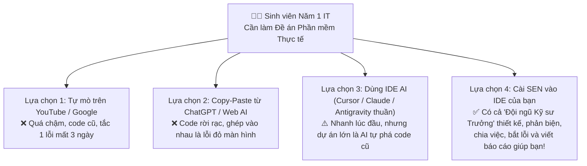
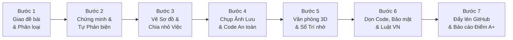
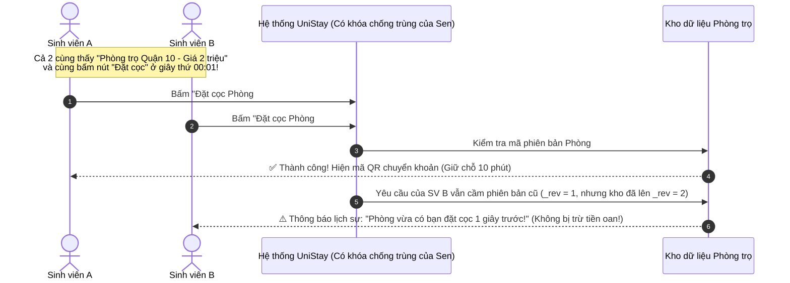

# 🎓 Cẩm Nang Dành Cho Sinh Viên Năm 1 IT: Tại Sao Chọn SEN & Cách SEN Giải Quyết Một Đề Án Khó Từ A–Z (Step-by-Step)

> **Dành cho bạn — Sinh viên Năm 1 IT:**  
> Bạn mới học `C/C++` hoặc `Python` cơ bản, mới biết `if/else`, vòng lặp `for`, chưa rành về "Kiến trúc hệ thống", "Cơ sở dữ liệu", "Bảo mật" hay "Triển khai (Deploy)". Nhưng học kỳ này bạn phải làm một **Đề án Phần mềm thực tế** để chấm điểm hoặc thi Hackathon.  
> Tài liệu này sẽ chỉ cho bạn thấy **tại sao dùng AI thông thường vẫn khiến 80% sinh viên "vỡ trận" đêm trước ngày nộp bài**, và **cách SEN biến bạn thành một "Giám đốc Dự án" có cả một đội ngũ Kỹ sư Đàn anh kèm cặp từng bước**.

- **Xem dạng Slide & Tab tương tác trực quan:** **[Sen-Tổng quan](https://raw.githack.com/developerfs0110/Sen/main/docs/sen-pitch-deck.html)** & **[Sen Office](https://raw.githack.com/developerfs0110/Sen/main/office/index.html)**
- **Quay lại Trang chủ:** **[Readme](../README.md)**

---

## Phần 1: Bạn đang có những lựa chọn nào? Tại sao phải chọn SEN?

Khi bắt tay vào làm đề án phần mềm, một sinh viên năm 1 thường đứng trước **4 lựa chọn**:



### Bảng so sánh bằng ngôn ngữ đời thường (Không thuật ngữ khó hiểu)

| Tình huống bạn sẽ gặp | Tự mò Google / YouTube | Chat với ChatGPT / AI thông thường | Dùng IDE AI thuần (chưa có Sen) | **Dùng IDE AI + Cài SEN (`sen-method`)** |
|---|---|---|---|---|
| **1. Không biết bắt đầu từ đâu** | Ngồi nhìn màn hình trắng cả tuần | AI ném cho 1 đoạn code dài ngoằng, không biết lưu vào đâu | AI lao vào viết code luôn khi chưa hỏi kỹ ý bạn | **Sen hỏi bạn vài câu dễ hiểu $\rightarrow$ Vẽ sơ đồ minh họa $\rightarrow$ Lập danh sách việc từ dễ đến khó** |
| **2. Sợ chọn sai cách làm (Thầy cô hỏi vặn là bí)** | Không biết cách nào tốt hơn | AI luôn khen cách bạn hỏi là "tuyệt vời" (dù cách đó sai) | AI làm theo cách đầu tiên nó nghĩ ra, dễ sập khi chạy thật | **Sen đưa ra các phương án tốt nhất, tự đóng vai "Giám khảo khó tính" để phản biện tìm điểm yếu, rồi chọn cách tối ưu nhất kèm bảng Chi phí** |
| **3. Sửa chỗ này lại hỏng chỗ kia** | Tự tìm trong hàng nghìn dòng code | Phải copy-paste từng file vào khung chat rất cực | AI sửa file mới làm hỏng luôn tính năng đã chạy hôm qua | **Sen tự động chụp "Ảnh lưu trạng thái" (Restore Point) trước khi sửa — hỏng là bấm 1 nút quay về nguyên trạng trong 1 giây!** |
| **4. Hôm sau mở máy lên làm tiếp** | Quên mất hôm qua đang làm dở chỗ nào | Cuộc chat dài quá, AI "lú lẫn" quên sạch yêu cầu đầu | AI phải đọc lại cả chục file từ đầu, vừa lâu vừa tốn lượt dùng | **Sen có "Sổ tay trí nhớ" (`CONTEXT.md`) và bảng việc tự động đánh dấu `[x]` — mở máy lên là làm tiếp ngay lập tức** |
| **5. Lúc mang đi chấm điểm / Bảo vệ đồ án** | Code chạy được trên máy mình nhưng lỗi tùm lum khi thầy cô test | Không có tài liệu thiết kế, không có bài kiểm tra tự động | Code dồn cục vào 1 file khổng lồ, lộ mật khẩu, vi phạm luật dữ liệu | **Sen tự động dọn code sạch đẹp (100/100 điểm), kiểm tra bảo mật & Luật VN, đẩy lên GitHub xanh 100% và viết sẵn Báo cáo Nghiệm thu!** |

---

## Phần 2: Minh Họa Thực Tế Step-by-Step — Giải Quyết Một Bài Toán Khó Cùng SEN

### 🎯 Đề bài Đồ án Thực tế (Bài toán khó):
Giả sử bạn cần làm ứng dụng Web + Mobile tên là **"UniStay — Tìm Phòng Trọ & Chợ Đồ Cũ Sinh Viên"** với 3 yêu cầu "khó nhằn":
1. Sinh viên đăng nhập bằng tài khoản trường, đăng tin tìm người ở ghép hoặc bán giáo trình cũ.
2. **Tính năng khó nhất (Đặt cọc giữ phòng bằng mã QR):** Phòng trọ giá rẻ vừa đăng lên có **50 sinh viên cùng bấm nút "Đặt cọc 500k" trong cùng 1 giây** — làm sao để hệ thống **chỉ nhận tiền của đúng 1 người đầu tiên**, không bị lỗi "1 phòng mà 5 người cùng chuyển tiền thành công"?
3. Có **Trợ lý AI tư vấn phòng trọ** phù hợp ngân sách và đưa sản phẩm lên mạng (Deploy) an toàn, đúng luật để trình chiếu trước Hội đồng chấm đồ án.

Hãy xem hành trình **7 Bước (Step-by-Step)** từ lúc mở máy tính đến khi hoàn thành đề án, và xem **tại sao dùng Sen lại vượt trội hoàn toàn ở từng bước**:



---

### 🔹 BƯỚC 1: Giao Đề Bài Bằng Lời Nói Tự Nhiên & Tự Động Đánh Giá Độ Khó

#### 1. Bạn làm gì?
Bạn mở IDE (như Antigravity, Cursor hoặc Claude Code đã cài Sen) và chỉ cần gõ đúng 1 câu bằng tiếng Việt tự nhiên như nói chuyện với bạn bè:
```text
Em là sinh viên năm 1, em muốn làm web và app UniStay giúp sinh viên tìm phòng trọ, có đăng nhập, đặt cọc giữ phòng bằng QR không bị trùng người, và có AI gợi ý phòng.
```

#### 2. Sen làm gì ngay lập tức? (Hình minh họa màn hình)
Ngay dòng đầu tiên, bộ chấm điểm thông minh của Sen (`Get-SenTaskRiskScore`) nhận ra đề bài của bạn có liên quan đến **Tài khoản (Đăng nhập)**, **Cơ sở dữ liệu (Lưu phòng trọ)** và **Tiền bạc (Đặt cọc QR)**. Sen lập tức bật chế độ bảo vệ cao nhất:

```text
+-----------------------------------------------------------------------------------+
| 🤖 SEN TRẢ LỜI:                                                                   |
| [Cấp 3 - Thiết kế & kế hoạch]                                                     |
|                                                                                   |
| Chào bạn! Đây là một đề án rất hay nhưng có 3 phần nhạy cảm:                      |
|   1. Lưu trữ dữ liệu phòng trọ (Database)                                        |
|   2. Đăng nhập tài khoản sinh viên (Auth)                                         |
|   3. Đặt cọc tiền giữ phòng (Payment - Rủi ro nhiều người bấm cùng lúc!)          |
|                                                                                   |
| -> Sen tự động bật quy trình Cấp 3: Thiết kế bản vẽ + Phản biện chống lỗi        |
|    tranh chỗ + Lập kế hoạch từng bước để bạn không bị rối nhé!                    |
+-----------------------------------------------------------------------------------+
```

#### 3. ⚔️ So sánh Bước 1: Dùng Cách Khác vs. Dùng SEN

| Tiêu chí ở Bước 1 | ❌ Khi dùng AI thông thường (ChatGPT / Cursor thuần) | ✅ Khi dùng SEN (`sen-method`) |
|---|---|---|
| **Phản ứng đầu tiên** | Nhảy bổ vào đẻ ra hàng trăm dòng code `index.html`, `server.js` ngay lập tức khi chưa biết bạn muốn dùng công nghệ gì. | Nhận diện ngay đây là bài toán **Cấp 3 (Rủi ro cao)**, tuyệt đối không viết code ẩu khi chưa có bản vẽ thiết kế. |
| **Nếu bạn sốt ruột giục `"Làm luôn đi đừng hỏi"`** | AI làm ẩu luôn, bỏ qua bảo mật và kiểm tra trùng tiền đặt cọc. | **Cơ chế Sàn cứng (`HardFloorTier3`):** Vì có dính tới Tiền bạc & Dữ liệu, Sen vẫn kiên quyết lập bản vẽ bảo vệ bạn chứ không làm ẩu! |

---

### 🔹 BƯỚC 2: Chọn Công Nghệ & Giải Bài Toán Khó Bằng "Chứng Minh — Phản Biện — Tối Ưu"

Đây là bước giúp bạn **ăn điểm tuyệt đối khi Thầy Cô hỏi vặn trong buổi bảo vệ đồ án**: *"Tại sao em chọn cách này mà không chọn cách kia? Nếu 50 người cùng bấm Đặt cọc 1 lúc thì sao?"*

#### 1. Sen suy nghĩ và trình bày cho bạn như thế nào?
Sen không chọn bừa. Sen thực hiện **Vòng lặp Biện chứng 3 Bước**:
1. **Chứng minh (Thesis):** Đề xuất các cách làm và tính toán rõ **Bảng Tài nguyên tiêu tốn** (Tốn bao nhiêu dung lượng máy? Mất bao lâu để làm? Có tốn tiền thuê server không?).
2. **Tự Phản biện (Antithesis):** Tự đóng vai "Thầy giáo khó tính" tìm cách đánh sập phương án để tìm ra lỗi **"50 người cùng bấm đặt cọc 1 phòng"**.
3. **Tối ưu (Synthesis):** Chốt phương án hoàn hảo nhất trước khi viết code.



#### 2. Bảng So sánh Phương án (Có cột Tài nguyên tiêu tốn) mà Sen lập sẵn cho bạn:

| Phương án xử lý Đặt cọc Phòng trọ | Giải thích dễ hiểu | Phản biện: Điều gì xảy ra nếu 50 người cùng bấm 1 lúc? | Tài nguyên tiêu tốn (Máy tính của bạn) | Kết luận của Sen |
|---|---|---|---|---|
| **Cách 1: Kiểm tra bằng `if` thông thường** | Kiểm tra `nếu phòng còn trống thì cho đặt` | ❌ **SẬP NGAY:** Cả 50 người cùng đi qua câu lệnh `if` trước khi phòng kịp đổi sang "Đã đặt" $\rightarrow$ 50 người cùng quét QR chuyển tiền! | Tốn ít RAM nhưng **sai nghiệp vụ nghiêm trọng** | Loại bỏ |
| **Cách 2: Dựng hệ thống Hàng đợi lớn (Kafka / Redis Cluster)** | Xếp 50 người vào ống chờ công nghiệp | ⚠️ Chống trùng được nhưng quá phức tạp, sinh viên năm 1 không thể cài đặt nổi trên laptop cá nhân. | **Nặng máy:** Tốn `2 GB RAM`, cài đặt mất `3 ngày`, tốn phí thuê server | Loại bỏ |
| **Cách 3 (*Best-of-the-Best*): Khóa Phiên Bản Lạc Quan (Optimistic Lock `_rev`) + Giữ chỗ 10 phút** | Mỗi phòng có 1 "Số thứ tự phiên bản" (`_rev`). Ai bấm trước thì số nhảy lên `2`, người bấm sau vẫn cầm số `1` sẽ bị chặn tự động ngay tại Kho dữ liệu! | ✅ **VƯỢT QUA 100%:** Kể cả 1.000 người bấm cùng lúc, chỉ đúng 1 người đầu tiên đổi được trạng thái, 999 người còn lại nhận thông báo ngay lập tức! | **Siêu nhẹ:** `0 MB` phần mềm phụ, chạy trong `2 phần nghìn giây`, miễn phí 100% | **CHỌN THỰC THI** |

#### 3. ⚔️ So sánh Bước 2: Dùng Cách Khác vs. Dùng SEN

| Tiêu chí ở Bước 2 | ❌ Khi dùng AI thông thường | ✅ Khi dùng SEN (`sen-method`) |
|---|---|---|
| **Xử lý bài toán 50 người cùng đặt cọc** | Viết code theo **Cách 1** (`if (room.status == 'free')`) $\rightarrow$ Lúc thầy cô chấm bài hỏi câu này là bạn bị trừ nửa số điểm! | Tự động phản biện loại bỏ Cách 1 & Cách 2, áp dụng **Cách 3** và giải thích cặn kẽ để bạn tự tin trả lời thầy cô. |

---

### 🔹 BƯỚC 3: Vẽ Sơ Đồ Trực Quan, Mô Phỏng Output (Phase 1) & Chia Đề Án Thành Các Bước Tự Động Đồng Bộ

#### 1. Sen làm gì cho bạn?
Sau khi chốt cách làm, Sen tạo ra 3 thứ cực kỳ trực quan trong thư mục dự án của bạn:
- **Bản vẽ Thiết kế (`docs/superpowers/specs/...`):** Có sẵn các sơ đồ hình vẽ mũi tên (Mermaid) được kiểm tra dấu thời gian đúng phiên làm việc hiện tại (`SessionStartedAtUtc` — `TASK-20`) — bạn có thể copy nguyên sơ đồ này dán thẳng vào file Word/PowerPoint báo cáo đồ án!
- **Mô phỏng Output Giai đoạn 1 (`Write-SenOfficeShowcase -Phase 1` $\rightarrow$ `.agents/office/showcase.json`):** Ngay từ trước khi bắt tay vào code chi tiết, Sen dựng sẵn bảng **Mô phỏng Đầu ra Kỳ vọng (Phase 1 Blueprint)** theo cơ chế *Read-Merge-Write* (ghi thêm mà không bao giờ xóa nhầm dữ liệu cũ) trên tab **`🎯 Đầu ra (2 Giai đoạn)`** của Văn phòng ảo để bạn hình dung rõ sản phẩm cuối cùng sẽ gồm những màn hình và tính năng gì!
- **Bảng Kế hoạch từng bước (`docs/superpowers/plans/...`) & Đồng bộ 2 chiều 0-Token:** Chia đề án thành từng bước nhỏ (Task 1, Task 2, Task 3...). Ngay khoảnh khắc file kế hoạch được lưu, Sen tự động biến các gạch đầu dòng đó thành danh sách công việc điện tử (`.agents/office/tasks.json`). Khi làm xong việc nào, Sen **tự động đánh dấu tích `[x]`** vào lại file văn bản cho bạn!

```text
📄 File Kế hoạch (Markdown)                   🗂️ Bảng Điều phối Tự động (tasks.json)
+-----------------------------------+         +----------------------------------------+
| ### Task 1: Tạo bảng Phòng trọ    | ======> | ID: PLAN-T1 | Trạng thái: [ĐÃ XONG ✅] |
| - [x] Tạo khung dữ liệu           | <====== | (Tự động tích [x] ngược lại file!)     |
|                                   |         |                                        |
| ### Task 2: Làm nút Đặt cọc QR    | ======> | ID: PLAN-T2 | Trạng thái: [ĐANG LÀM 🔄]|
| - [ ] Chống 2 người đặt trùng     |         | Khóa bảo vệ file: src/booking.js       |
+-----------------------------------+         +----------------------------------------+
                      ||
                      \/
🎯 Bảng Mô Phỏng Output 2 Giai Đoạn (showcase.json trên Văn phòng 3D)
+-----------------------------------+--------------------------------------------------+
| 📐 GIAI ĐOẠN 1 (Kỳ vọng Thiết kế) | ✅ GIAI ĐOẠN 2 (Kết quả Thực tế & 4 Cổng Kiểm)   |
| • Bản đồ tìm trọ quanh trường     | • Đã kiểm chứng khi bàn giao (Tests/Build/Sec/Law|
| • Đặt cọc QR khóa chống trùng _rev|   đều hiện đèn xanh PASS 4/4!)                   |
+-----------------------------------+--------------------------------------------------+
```

#### 2. ⚔️ So sánh Bước 3: Dùng Cách Khác vs. Dùng SEN

| Tiêu chí ở Bước 3 | ❌ Khi dùng AI thông thường | ✅ Khi dùng SEN (`sen-method`) |
|---|---|---|
| **Hình dung kết quả & Quản lý tiến độ** | Làm mù mờ không biết sản phẩm lúc xong sẽ trông ra sao; bạn phải tự nhớ phần nào làm rồi, phần nào chưa làm; AI rất hay bỏ quên yêu cầu nhỏ. | Có **Mô phỏng Output 2 Giai đoạn (`showcase.json`)** đối chiếu Kỳ vọng vs. Thực tế + Hệ thống Kiểm toán 12 Bước (`Test-SenProjectCompliance`) không bỏ sót bất kỳ việc nào. |

---

### 🔹 BƯỚC 4: Chụp "Ảnh Lưu Trạng Thái" (Restore Point) & Viết Code Có Bài Kiểm Tra Tự Động

#### 1. Nỗi sợ lớn nhất của Sinh viên Năm 1 là gì?
Đó là: *"Đồ án đang chạy ngon lành được 80%, em bảo AI thêm tính năng mới, thế là nó sửa một hồi hỏng luôn cả 80% cũ, màn hình trắng xóa mà không biết đường nào quay lại!"*

#### 2. Sen bảo vệ bạn như thế nào?
- **Chụp điểm khôi phục tự động (`New-SenRestorePoint`):** Trước khi chạm vào bất kỳ file code nào của bạn, Sen tự động chụp lại một bản sao nguyên vẹn cất vào két sắt ẩn. Nếu bạn không ưng ý, chỉ cần bảo *"Hoàn tác giúp mình"* (`Restore-SenRestorePoint`), mọi thứ quay về đúng từng chữ như 1 giây trước đó!
- **Lá chắn an toàn (`guard.ps1`):** Nếu AI (hoặc chính bạn) vô tình chạy lệnh xóa nhầm thư mục (`rm -rf`, `Remove-Item -Recurse`) hoặc đẩy đè mất bài trên GitHub (`git push --force`), lá chắn của Sen sẽ **chặn đứng ngay lập tức** trước khi lệnh đó kịp chạy!
- **Thực thi Song song Lạc quan & Thăm dò Sự sống 3 Tín hiệu (`Test-SenHungTasks` & `Clear-SenHungTasks` — `TASK-21` & `TASK-22`):** Trong lúc bạn đang đọc phần giải thích của Sen trên màn hình, ở bên dưới các trợ lý AI của Sen đã đồng thời viết xong code và tự chạy bài kiểm tra (Test). Đặc biệt, bộ thăm dò sự sống 3 tín hiệu bảo vệ tuyệt đối các việc chạy lâu đang có nhịp tim thực thi (`ActiveLongRunningIds`), phát hiện tức thì các lệnh bị đơ chờ bấm phím (`DeadlockedItems`), và tự động dọn dẹp các tác vụ treo (`StaleTaskIds`) cùng trợ lý phụ đã nghỉ (`IdleSubagents`) để laptop của bạn luôn mượt mà!

#### 3. ⚔️ So sánh Bước 4: Dùng Cách Khác vs. Dùng SEN

| Tiêu chí ở Bước 4 | ❌ Khi dùng AI thông thường | ✅ Khi dùng SEN (`sen-method`) |
|---|---|---|
| **Khi AI sửa nhầm hoặc xóa nhầm file** | Mất trắng buổi tối làm việc, phải ngồi nhấn `Ctrl+Z` từng file trong tuyệt vọng. | Có sẵn két sắt `Restore Point` khôi phục chính xác 100% chỉ bằng 1 câu lệnh + Lá chắn `guard.ps1` chặn mọi lệnh phá hoại. |

---

### 🔹 BƯỚC 5: Mở "Văn Phòng 3D Chibi" Xem Đội AI Làm Việc & Tắt Máy Đi Ngủ Không Sợ Quên

#### 1. Bạn làm gì?
- Bất cứ lúc nào muốn xem đội AI đang phối hợp ra sao, bạn chỉ cần gõ: **`"mở văn phòng"`**.
- Ngay lập tức, một **Văn phòng 3D Chibi (`sen-office`)** hiện ra trên trình duyệt: bạn thấy nhân vật **Boss (chính là bạn)** ngồi trên ghế sofa đỏ, xung quanh là **Quản lý dự án (PM)**, **Kiến trúc sư (BA)**, **Trinh sát tìm tài liệu (Scout)**, **Lập trình viên Giao diện (FE)**, **Lập trình viên Hệ thống (BE)**, **Kiểm thử viên (QA)** và **Chuyên gia Bảo mật (Security)** đang di chuyển và báo cáo công việc qua bộ đàm!
- Khi đến 11 giờ đêm bạn buồn ngủ, bạn cứ đóng máy đi ngủ. Sáng hôm sau mở máy lên, nhờ cơ chế **`Cold-Start 1-File`**, Sen chỉ cần đọc đúng 1 file tóm tắt trí nhớ (`docs/CONTEXT.md`) trong 1 giây là nhớ toàn bộ đồ án của bạn đang ở đâu để làm tiếp ngay!

```text
+-----------------------------------------------------------------------------------+
| 🏢 VĂN PHÒNG AI 3D CHIBI (sen-office - Chế độ Tiết kiệm 0 Token)                  |
|                                                                                   |
|   [🛋️ BOSS: Bạn]        [📋 PM: Điều phối]       [📐 BA: Thiết kế Sơ đồ]          |
|                                                                                   |
|   [🎨 FE Dev: Giao diện] [⚙️ BE Dev: Đặt cọc QR]  [🧪 QA: Chạy Test]  [🛡️ Sec]   |
|                                                                                   |
| 📻 Bộ đàm trực tiếp:                                                              |
|   • [BE Track] Edit code: booking.js (Đã khóa chống trùng _rev)                   |
|   • [QA Gate]  Run test suite: 15/15 bài test đặt cọc thành công!                 |
+-----------------------------------------------------------------------------------+
```

#### 2. ⚔️ So sánh Bước 5: Dùng Cách Khác vs. Dùng SEN

| Tiêu chí ở Bước 5 | ❌ Khi dùng AI thông thường | ✅ Khi dùng SEN (`sen-method`) |
|---|---|---|
| **Hôm sau mở cuộc trò chuyện mới** | Phải giảng lại từ đầu cho AI nghe đề án của mình là gì, hoặc bắt AI đọc lại cả chục file làm hết sạch hạn mức (Quota) tài khoản miễn phí/sinh viên. | Chỉ đọc đúng 1 file `docs/CONTEXT.md` (tiết kiệm **70% lượng Token**), giữ hạn mức tài khoản của bạn dùng được lâu gấp 3 lần! |

---

### 🔹 BƯỚC 6: Tự Động Dọn Code Sạch Đẹp (100/100) + Kiểm Tra Bảo Mật & Luật Pháp Việt Nam

Đây là bước biến đồ án của một **Sinh viên Năm 1** thành sản phẩm có chất lượng của một **Kỹ sư Đi làm Thực thụ**:

#### 1. Sen tự động kiểm tra 3 tầng chất lượng nào trước khi cho phép nộp bài?
1. **Dọn dẹp Code Sạch 6 Chiều (`Measure-SenCodeHealth`):**
   - Sinh viên dùng AI rất hay gặp tình trạng AI nhồi nhét tất cả vào 1 file dài 2.000–3.000 dòng, biến tên đặt lung tung, có những đoạn code thừa không bao giờ chạy tới.
   - Sen tự động quét và đảm bảo không có file logic nào dài quá `800 dòng`, không có hàm nào dài quá `100 dòng`, không có code lặp lại — chấm điểm sức khỏe mã nguồn đạt **100/100**.
2. **Rà soát Bảo mật & Che giấu Mật khẩu (`Protect-SenRedactedText` & `security-audit`):**
   - Không bao giờ để lộ mật khẩu cơ sở dữ liệu hay chìa khóa kết nối AI (API Key) lên mạng.
3. **Kiểm tra Tuân thủ Pháp luật Việt Nam (`Invoke-SenVnLawScan`):**
   - Vì ứng dụng **UniStay** của bạn có thu thập Số điện thoại/Email sinh viên, có gửi thông báo đặt cọc qua Bot Telegram/Zalo, có dùng AI tư vấn và có bản Mobile App:
     - Sen tự động kiểm tra ứng dụng đã có **ô tích đồng ý chính sách bảo mật (không tích sẵn)** theo đúng **Luật Bảo vệ dữ liệu cá nhân `91/2025/QH15` & Nghị định `356/2025/NĐ-CP`** chưa, và chặn lỗi Bot/Backend tự động bắn ảnh biên lai chuyển khoản hay thông tin nhạy cảm sang nhóm chat thứ ba khi chưa xin phép riêng (`BOT_DATA_FORWARDING_WITHOUT_CONSENT` — `TASK-20`).
     - Sen kiểm tra bản Mobile App đã có nút **"Xóa tài khoản"** chưa, và khung chat AI đã gắn nhãn **"Trợ lý AI"** theo **Luật Trí tuệ nhân tạo `134/2025/QH15`** chưa!

#### 2. ⚔️ So sánh Bước 6: Dùng Cách Khác vs. Dùng SEN

| Tiêu chí ở Bước 6 | ❌ Khi dùng AI thông thường | ✅ Khi dùng SEN (`sen-method`) |
|---|---|---|
| **Chất lượng code & Pháp lý khi thầy cô chấm** | Code rối rắm trong 1 file khổng lồ, lộ API Key trên GitHub, thiếu quy chuẩn dữ liệu cá nhân. | Điểm sức khỏe code **100/100**, có sẵn chứng nhận vượt qua cổng Bảo mật & Luật Việt Nam 2025/2026 — ghi điểm tuyệt đối với Hội đồng chấm thi! |

---

### 🔹 BƯỚC 7: Cập Nhật Mô Phỏng Output (Phase 2), Đẩy Lên GitHub Tự Chữa Lành & Xuất Báo Cáo Nghiệm Thu

#### 1. Sen hoàn tất đề án cho bạn như thế nào?
- **Cập nhật Mô phỏng Output Giai đoạn 2 (`Write-SenOfficeShowcase` — Phase 2 Verified Output):**
  - Ngay trước khi bàn giao, Sen tự động điền toàn bộ sản phẩm thực tế đã kiểm chứng và trạng thái 4 cổng (`Tests: PASS`, `Build: PASS`, `Bảo mật: PASS`, `Pháp lý: PASS`) vào tab **`🎯 Đầu ra (2 Giai đoạn)`** của Văn phòng ảo. Khi lên bảo vệ đồ án trước thầy cô, bạn chỉ cần bật màn hình đối chiếu **Giai đoạn 1 (Cam kết ban đầu) vs. Giai đoạn 2 (Sản phẩm thật đã kiểm chứng)** là thuyết phục 100%!
- **Vòng lặp Đẩy code & Tự chữa lành từ xa (`Invoke-SenCiPushLoop`):**
  - Khi đưa code lên GitHub để triển khai (Deploy), nếu trên máy chủ GitHub báo lỗi môi trường, Sen tự động đọc bước bị lỗi, tự sửa code ở máy bạn, chạy lại bài test và đẩy lên lại (tối đa 3 lần) cho đến khi biểu tượng trên GitHub hiện **Màu Xanh Lá 100% (`success`)**!
- **Xuất Báo cáo Nghiệm thu (`sen-delivery-report`):**
  - Cuối cùng, Sen tổng hợp cho bạn một bản **Báo cáo Nghiệm thu hoàn chỉnh** gồm: danh sách tính năng đã làm, sơ đồ kiến trúc, kết quả chạy bài kiểm tra tự động, điểm sức khỏe code và hướng dẫn chạy thử — bạn có thể dùng ngay làm **Báo cáo Tổng kết Đồ án**!

---

## Phần 3: Tóm Lại — Chỉ Với 1 Câu Lệnh, Sinh Viên Năm 1 Nhận Được Gì Từ SEN (`v0.4.0` — `73/73` Cmdlets, `237/237` Tests, `22/22` Tasks)?

```text
+===================================================================================+
| 🎓 KẾT QUẢ CUỐI CÙNG KHI BẠN DÙNG SEN (v0.4.0) LÀM ĐỀ ÁN:                         |
|                                                                                   |
|  1. Không cần biết thuật ngữ khó  ---> Nói tiếng Việt tự nhiên, Sen tự phân tích  |
|  2. Không sợ chọn sai giải pháp   ---> Có Vòng lặp Chứng minh - Phản biện bảo vệ  |
|  3. Không sợ sửa hỏng code cũ     ---> Có Restore Point quay lui trong 1 giây     |
|  4. Không sợ treo máy hay đơ IDE  ---> Có Liveness Probe 3 tín hiệu tự dọn dẹp    |
|  5. Không sợ hết lượt dùng AI     ---> Tiết kiệm 70% Token nhờ Cold-Start 1-File  |
|  6. Không sợ thầy cô bắt bẻ code  ---> Clean Code 100/100 + Đúng Luật VN 2025     |
|  7. Dùng được trên mọi phần mềm   ---> Antigravity, Cursor, Claude, Copilot...    |
+===================================================================================+
```

👉 **Bắt đầu ngay trong 1 phút:** Quay lại mục **[Bắt đầu nhanh trong README](../README.md)** hoặc xem **[Hướng dẫn cài đặt chi tiết cho người mới](./huong-dan.md)**.

