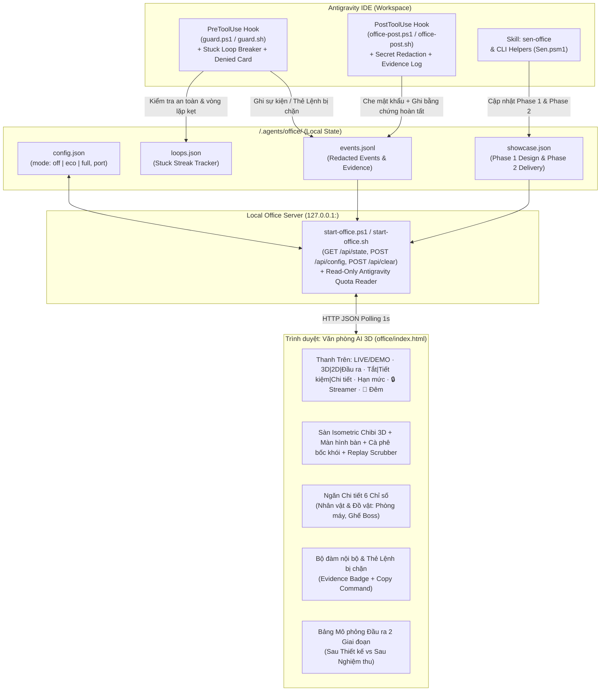

# Thiết kế Chi tiết Phần 2: `sen-office` (`v0.2.0`) — Văn phòng AI 3D, 10 Tinh hoa Quản trị & Bảng Mô phỏng Đầu ra Dự án

**Ngày:** 2026-11-06  
**Phiên bản mục tiêu:** `0.2.0` (tích hợp trực tiếp trong kho `https://github.com/developerfs0110/Sen`)  
**Tác giả:** Mr Bòn Bon  

---

## 1. Mục đích & Tầm nhìn (Intent & The Why)

Khi làm việc với đội AI agent trong IDE, người dùng thường chỉ nhìn thấy một luồng chữ chạy dài trong khung chat — khó hình dung AI đang phân công vai trò nào, đang đọc hay sửa file nào, có bị kẹt vòng lặp đốt token hay không, và sản phẩm sau khi thiết kế/bàn giao trông ra sao.

**`sen-office` (`v0.2.0`)** biến toàn bộ hoạt động của đội AI trong **Sen** thành một **Trung tâm Chỉ huy & Văn phòng AI 3D trực quan trên trình duyệt** kết hợp **Bảng Mô phỏng Đầu ra 2 giai đoạn (Dual-Phase Domain Visualizer)**:
1. **Dàn nhân vật Chibi Designer-Toy / Pixar 3D sống động:** Đổ bóng khối 3D (`radialGradient`), mắt chớp tự nhiên có đốm sáng, giày sneaker đế trắng, vòng sáng trạng thái dưới mặt sàn (không che mặt), trang phục & đạo cụ nghề nghiệp riêng cho từng vai trò (**Boss** ngồi sofa nhung đỏ đeo kính râm hút xì gà, **PM**, **BA**, **Trinh sát 1–2**, **Dev FE/BE**, **Tester nữ**, **Bảo mật**, **Pháp lý**, và **Phòng máy**).
2. **Bằng chứng thật 100%, mặc định 0 tốn token:** Dùng cơ chế Hook (`PreToolUse` & `PostToolUse`) của Antigravity IDE để tự động bắt các thao tác thật (đọc file, sửa file, chạy lệnh test/build, chặn lệnh nguy hiểm, gọi subagent) và phát lên văn phòng 3D mà không tốn thêm bất kỳ token LLM nào ở chế độ mặc định (`Tiết kiệm`).
3. **Tích hợp trọn vẹn 10/10 Tinh hoa Thiết kế & Chức năng (học hỏi và chắt lọc từ `khanh020905/my-office`):**
   - **6 nâng cấp UI / Hiển thị:** (1) Màn hình máy tính trên bàn đổi màu/icon theo việc; (2) Đồ vật tương tác trên sàn (`Place Cards`: Phòng máy, Ghế Boss, Khu Kiểm định); (3) Ngăn chi tiết nhân vật có 6 ô đếm nhanh (`Đọc · Sửa · Lệnh · Thời gian · Model · Trạng thái`); (4) Hiệu ứng đời sống văn phòng tinh tế (Tách cà phê bốc khói, Pháo giấy chúc mừng khi bàn giao, Công tắc Ngày/Đêm `🌙/☀️`); (5) Nút chuyển đổi `🏢 3D | 📋 2D Gọn | 🎯 Đầu ra 2 Giai đoạn` + nút `🔒 Ẩn nhạy cảm (Streamer Mode)`; (6) Thanh Tua lại Lịch sử (`Replay Timeline Scrubber`).
   - **4 cơ chế Chức năng "Vàng":** (7) Ngắt vòng lặp kẹt tự động (`Stuck Loop Breaker` — chặn khi cùng một lệnh lỗi giống hệt nhau 3 lần liền); (8) Tự động che mật khẩu / API Key (`Secret Redaction` bằng 10 mẫu Regex trước khi ghi log); (9) Thẻ "Lệnh bị chặn" (`Denied Command Card` kèm nút Copy lệnh); (10) Thanh Hạn mức Model Antigravity chỉ-đọc (`Antigravity Quota Pill` đọc `read-only` từ `state.vscdb` nếu có).
4. **Xem trước & Nghiệm thu theo lĩnh vực (Dual-Phase Simulation):** Đối chiếu trực quan giữa **Giai đoạn 1 (Sau Thiết kế & Kế hoạch — Kỳ vọng)** và **Giai đoạn 2 (Sau Bàn giao & Nghiệm thu — Kết quả thật & 4 Cổng kiểm duyệt)**.

---

## 2. Mục tiêu, Phi mục tiêu & Chống mục tiêu (Goals, Non-Goals, Anti-Goals)

### 2.1. Mục tiêu (Goals)
- **Đóng gói chung trong repo `Sen`:** Cài Sen (`install.ps1` / `install.sh`) là có sẵn `sen-office` (`office/index.html`, `skills/sen-office/SKILL.md`, `scripts/office-post.ps1`/`.sh`, `scripts/start-office.ps1`/`.sh`, và các hàm trong `scripts/Sen.psm1`).
- **Không phụ thuộc thư viện ngoài (Zero External Dependencies):**
  - Giao diện `office/index.html` viết bằng HTML5 + SVG Isometric Chibi 3D + CSS + Vanilla JS thuần trong một file độc lập.
  - Trạm điều phối nội bộ (`Local Office Server`) dùng `System.Net.Sockets.TcpListener` có sẵn trong Windows PowerShell 5.1+ và `python3` có sẵn trên macOS/Linux.
- **Giao tiếp 2 chiều thời gian thực + Fallback Demo tĩnh:**
  - Khi kết nối với `start-office.ps1` / `.sh` (`http://127.0.0.1:<port>`), trình duyệt đọc `/api/state` (gộp `config.json`, `events.jsonl`, `showcase.json`, `quota`) và gửi `POST /api/config` khi đổi công tắc `Tắt / Tiết kiệm / Chi tiết`.
  - Khi mở trực tiếp file `office/index.html` qua `file://`, tự động chạy mượt ở **Chế độ Demo** với đầy đủ kịch bản Cấp 1, Cấp 2, Cấp 3 và dữ liệu mẫu.

### 2.2. Phi mục tiêu (Non-Goals)
- Không dùng Next.js, React hay Three.js nặng hàng chục MB; không đưa các yếu tố game đường phố gây xao nhãng.

### 2.3. Chống mục tiêu (Anti-Goals)
- **Không bao giờ làm chậm hoặc làm treo câu lệnh của IDE:** Mọi thao tác ghi sự kiện của Hook đều bọc trong `try/catch`, và khi `mode == "off"` thì thoát ngay lập tức (`0` thao tác ghi).
- **Không bao giờ ghi đè hay can thiệp vào `state.vscdb` của Antigravity IDE:** Việc đọc hạn mức model (nếu có) là **100% chỉ-đọc (`read-only`)**.
- **Không bao giờ lưu lộ mật khẩu / API Key vào `.agents/office/events.jsonl`:** Mọi chuỗi đầu vào đều đi qua hàm `Protect-SenRedactedText` trước khi ghi.

---

## 3. Các phương án kiến trúc đã cân nhắc (Approaches)

| Phương án | Mô tả | Đánh đổi (Trade-offs) | Quyết định |
|---|---|---|---|
| **A. Trạm điều phối nhẹ nội bộ (`Local Office Server` + `.agents/office/*.json*`) + Fallback tĩnh** | Dùng PowerShell `TcpListener` (Windows) & `python3` (POSIX) phục vụ `office/index.html` và các endpoint `/api/state`, `/api/config`, `/api/event`, `/api/clear`. Tự fallback sang Demo nếu mở `file://`. | Cần 1 tiến trình nền nhẹ khi muốn kết nối 2 chiều với workspace thật, nhưng **0 thư viện ngoài**, lưu được nút bấm `Tắt/Tiết kiệm/Chi tiết` xuống đĩa và cập nhật realtime. | **ĐÃ CHỌN** |
| **B. File HTML tĩnh nạp lại `office-state.js`** | Ghi đè file `.js` định kỳ để HTML tự nạp lại. | Trình duyệt mở qua `file://` không thể ghi ngược cấu hình `Tắt/Tiết kiệm/Chi tiết` xuống `.agents/office/config.json`. | Loại |
| **C. Ứng dụng Node.js / Vite riêng** | Dựng server Express/Vite + WebSocket. | Bắt buộc cài Node.js và `node_modules` nặng nề, trái nguyên lý gọn nhẹ của Sen. | Loại |

---

## 4. Kiến trúc Hệ thống & Luồng Dữ liệu (System Architecture)

---

## 5. Thiết kế Chi tiết Từng Thành phần

### 5.1. Các Hàm Quản trị Văn phòng trong `scripts/Sen.psm1` (100% ASCII-only)

1. **`Protect-SenRedactedText -Text <string>`:**
   - Thay thế các mẫu nhạy cảm thành `[REDACTED]`:
     - `Bearer <token>`
     - `sk-...`, `pk-...`, `rk-...` (`>= 8` ký tự)
     - `ghp_...`, `gho_...`, `ghu_...`, `ghs_...`, `ghr_...`
     - `xox[abpr]-...`
     - JWT `eyJ...`
     - `(api_key|access_key|token|secret|password|passwd|pwd|authorization|cookie)\s*[:=]\s*[^\s"'&]+`
     - Thông tin xác thực trong URL `://user:pass@`
2. **`Get-SenOfficeConfig -Workspace <string>` & `Set-SenOfficeConfig -Workspace <string> -Mode <off|eco|full> [-Port <int>]`:**
   - Đọc/ghi nguyên tử `<WORKSPACE>/.agents/office/config.json` (mặc định `mode = "eco"`, `port = 47890`).
3. **`Write-SenOfficeEvent` & `Read-SenOfficeEvents` & `Clear-SenOfficeEvents`:**
   - Tự động gọi `Protect-SenRedactedText` trên `ecoText`, `fullText`, `target`, và `command` trước khi ghi vào `<WORKSPACE>/.agents/office/events.jsonl`.
   - Khi `mode == "off"`, `Write-SenOfficeEvent` trả về `$false` ngay lập tức và không tạo/ghi file.
   - Giữ tối đa 200 dòng sự kiện mới nhất để file luôn gọn nhẹ.
4. **`Test-SenStuckLoop -Workspace <string> -ToolName <string> -Target <string> [-Failed] [-ErrorText <string>] [-Reset]`:**
   - Lưu trạng thái chuỗi lỗi liên tiếp trong `<WORKSPACE>/.agents/office/loops.json`.
   - Khi cùng một `ToolName + Target` thất bại **3 lần liên tiếp** (`streak >= 3`), trả về `@{ IsStuck = $true; Streak = $n; Reason = "..." }` để `guard.ps1` chặn ở lần gọi thứ 4 và phát sự kiện `kind = "alert"` lên văn phòng 3D. Khi thành công hoặc sửa file mới thì tự động xóa streak (`Reset`).
5. **`Write-SenOfficeShowcase` & `Read-SenOfficeShowcase`:**
   - Đọc/ghi dữ liệu Mô phỏng Đầu ra 2 Giai đoạn tại `<WORKSPACE>/.agents/office/showcase.json`.
6. **`Get-SenAntigravityQuota`:**
   - Đọc an toàn ở chế độ **chỉ-đọc (`read-only`)** thông tin hạn mức model từ cơ sở dữ liệu trạng thái của Antigravity IDE (nếu tìm thấy trên máy); nếu không tìm thấy hoặc không có `sqlite3`, trả về trạng thái mặc định mà không bao giờ báo lỗi.

### 5.2. Mở rộng Hook `PreToolUse` & `PostToolUse` (`hooks.json`, `guard.ps1`/`.sh`, `office-post.ps1`/`.sh`)

- **`hooks.json`:**
  - `PreToolUse` (`matcher: "run_command|write_file|edit_file"`): chạy `scripts/guard.ps1` (hoặc `bash scripts/guard.sh` trên macOS/Linux).
    - Nếu lệnh bị từ chối (`decision: "deny"`), tự động ghi một sự kiện **Thẻ Lệnh bị chặn (`kind: "alert"`, `source: "guard-denied"`, kèm `command` đã che mật khẩu)** từ `sec` (Bảo mật) tới `pm` vào `.agents/office/events.jsonl`.
    - Kiểm tra `Test-SenStuckLoop`: nếu lệnh đó đã lỗi giống hệt nhau 3 lần liên tiếp trong `loops.json`, trả về `decision: "deny"` kèm lời nhắc đổi hướng cho AI!
  - `PostToolUse` (`matcher: "run_command|write_file|edit_file|read_file|grep_search|find_by_name"`): chạy `scripts/office-post.ps1` (hoặc `bash scripts/office-post.sh`).
    - Đọc `config.json`: nếu `mode == "off"`, thoát ngay trong `< 5ms`.
    - Nếu `mode` là `"eco"` hoặc `"full"`, ánh xạ tên công cụ & đường dẫn file sang đúng nhân vật (`r1`/`r2` khi tìm kiếm, `ba` khi đọc spec/template, `fe` khi sửa `.html/.css/.tsx`, `be` khi sửa script/code backend, `qa` khi chạy test, `sec` khi chạy `Validate-Repo` hoặc kiểm tra bảo mật) và ghi dòng sự kiện bằng chứng (`source: "hook-post"`) vào `.agents/office/events.jsonl`.

### 5.3. Giao diện `office/index.html` (Tích hợp Đầy đủ Tạo hình Chibi 3D + 10 Tinh hoa + Dual-Phase)

- **Tạo hình Chibi 3D Mới:** Không có vòng xanh bo quanh mặt; vòng sáng trạng thái nằm dưới mặt đất dưới chân mỗi nhân vật; có nút chuyển đối chiếu tạo hình hoặc chuyển cảnh **Ngày / Đêm (`🌙 / ☀️`)**.
- **3 Chế độ Xem Chính trên Thanh Công cụ:**
  1. **`🏢 Sàn Văn phòng 3D`:** Sàn isometric xoay `-60°..+60°`, màn hình máy tính trên bàn đổi màu/icon theo tác vụ, tách cà phê bốc khói, pháo giấy chúc mừng khi bàn giao xong, bấm vào nhân vật hoặc đồ vật (Phòng máy, Ghế Boss, Khu Kiểm định) mở **Ngăn Chi tiết 6 Chỉ số**.
  2. **`📋 Danh sách 2D Gọn`:** Xem toàn bộ 10 vai trò dạng bảng ngang tối giản (trạng thái, số lần Đọc/Sửa/Lệnh, công việc hiện tại, thời gian) cho máy yếu hoặc khi cần tra cứu nhanh.
  3. **`🎯 Mô phỏng Đầu ra (2 Giai đoạn)`:** Đối chiếu trực quan **Giai đoạn 1 (Kỳ vọng sau Thiết kế & Kế hoạch)** và **Giai đoạn 2 (Kết quả thật & 4 Cổng kiểm duyệt Test / Build / Bảo mật / Pháp lý sau Nghiệm thu)**.
- **Thanh Tua lại Lịch sử (`Replay Scrubber`):** Cho phép kéo thanh trượt xem lại từng bước từ đầu phiên làm việc hoặc phát lại ở tốc độ `1x / 2x / 4x`.
- **Nút `🔒 Ẩn nhạy cảm (Streamer Mode)`:** Che mờ tên đường dẫn/câu lệnh nhạy cảm trên giao diện khi quay màn hình hoặc chụp ảnh chia sẻ.
- **Thẻ `🛑 LỆNH BỊ CHẶN` trong Bộ đàm nội bộ:** Hiển thị rõ lệnh nào vừa bị `guard` chặn, lý do chặn, và nút **`📋 Chép lệnh`**.
