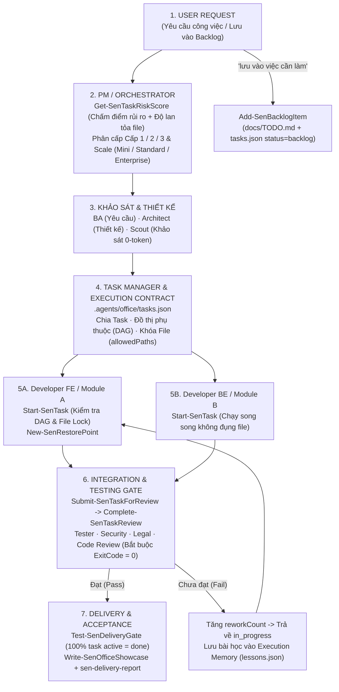
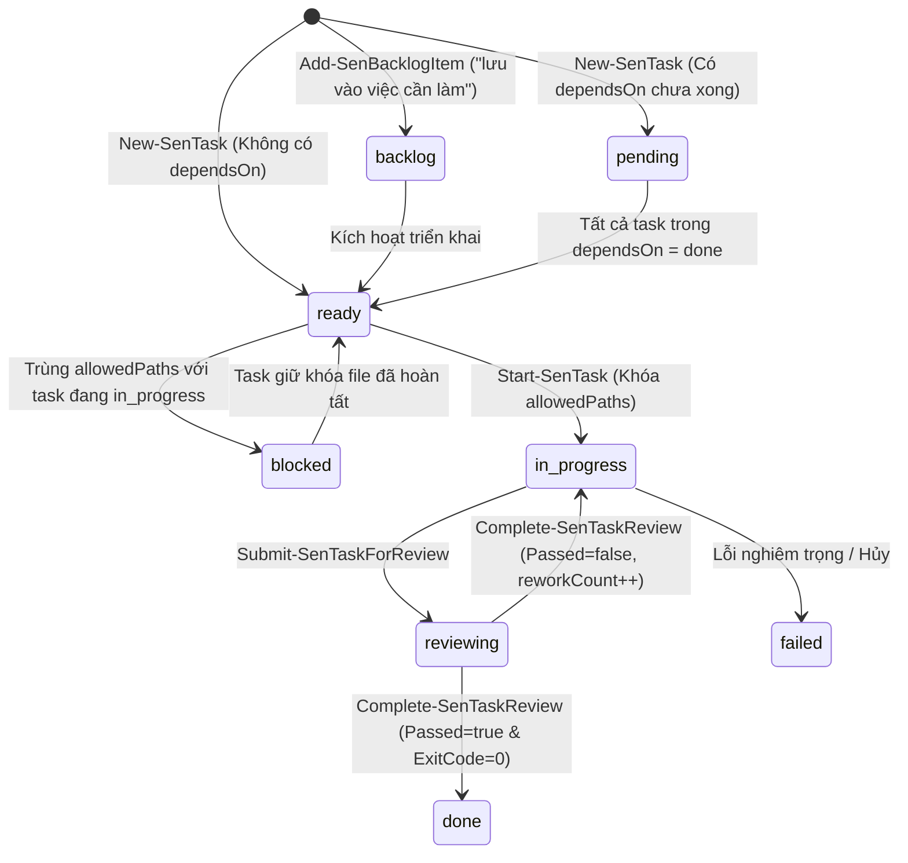

# Thiết Kế & Kế Hoạch Triển Khai — Sen `v0.3.0` (Orchestrator, Task Manager & AI Control Center)

- **Ngày:** 2026-11-06
- **Phiên bản mục tiêu:** `0.3.0`
- **Cấp độ:** `[Cấp 3 - Thiết kế & kế hoạch]` (Nâng cấp kiến trúc điều phối Agent, quản lý trạng thái Task, chấm điểm rủi ro xác định, bảo vệ chuỗi cung ứng & Control Center)
- **Phương thức thực thi:** **Native (Thực thi trực tiếp một luồng)** — do 10 hạng mục (`TASK-01` → `TASK-10`) cùng chia sẻ `scripts/Sen.psm1`, `rules/AGENTS.md`, `scripts/guard.ps1` và `office/index.html`.

---

## 1. Sơ đồ Kiến trúc Điều phối 7 Tầng (`Sen v0.3.0`)

---

## 2. Sơ đồ Vòng đời Trạng thái Task (`Task State Machine`)

---

## 3. Danh sách 10 Hạng mục Triển khai (`TASK-01` → `TASK-10`)

1. **`TASK-01` (P0 — Task State Engine, Execution Contract, DAG & Recovery):**
   - Bổ sung vào `scripts/Sen.psm1`: `New-SenTask`, `Get-SenTasks`, `Save-SenTasks`, `Clear-SenTasks`, `Get-SenReadyTasks`, `Start-SenTask`, `Submit-SenTaskForReview`, `Complete-SenTaskReview`, `Test-SenDeliveryGate`, `Get-SenRecoveryState`, `Get-SenQualityMetrics`.
2. **`TASK-02` (P0 — Quy trình Backlog `docs/TODO.md` + `Add-SenBacklogItem`):**
   - Bổ sung hàm `Add-SenBacklogItem` trong `scripts/Sen.psm1` và cập nhật Mục 10 của `rules/AGENTS.md` (giữ dung lượng `<= 6.000` bytes và `<= 99` dòng).
3. **`TASK-03` (P0 — Bộ chấm điểm rủi ro có cấu trúc `Get-SenTaskRiskScore` & Tự động hóa 32 kịch bản phân cấp):**
   - Bổ sung `Get-SenTaskRiskScore` trong `scripts/Sen.psm1`, viết bộ test tự động `tests/TierScenarios.Tests.ps1` kiểm chứng toàn bộ 32 tình huống và điền bảng kết quả `32/32` trong `tests/tier-scenarios.md`.
4. **`TASK-04` (P0 — Sửa lỗi dương tính giả trong `tests/run.ps1` & thiếu `office` trong `Update-SenPackages`):**
   - Sửa `tests/run.ps1` trả `exit 1` khi không tìm thấy file test hoặc tổng số bài test bằng `0`.
   - Bổ sung `"office"` và `"AGENTS.md"` vào `$senPayload` của `Update-SenPackages` và `Install-SenSelf`.
5. **`TASK-05` (P1 — Ghim commit phụ thuộc `pinnedCommit` trong `scripts/packages.json` & Git Tag):**
   - Thêm `pinnedCommit` cho `superpowers`, `security-audit`, `vn-law-check` trong `scripts/packages.json` và gắn tag `v0.1.0`, `v0.1.1`, `v0.2.0`, `v0.3.0`.
6. **`TASK-06` (P1 — Bảo vệ `allowedPaths` / file nhạy cảm trong `guard` & Điểm khôi phục tự động `New-SenRestorePoint`):**
   - Thêm `New-SenRestorePoint` và `Restore-SenRestorePoint` vào `scripts/Sen.psm1`.
   - Nâng cấp `scripts/guard.ps1` và `scripts/guard.sh` kiểm tra `allowedPaths` của task đang chạy và chặn xóa/ghi đè trái phép `.git/config`.
7. **`TASK-07` (P1 — Điều phối Hook đa nền tảng & Chuẩn hóa đường dẫn):**
   - Chuẩn hóa cách tìm đường dẫn gốc plugin trong `guard.sh`, `office-post.sh`, `install.sh` và kiểm thử đa nền tảng.
8. **`TASK-08` (P2 — Nâng cấp `Sen Office` thành `AI Control Center`):**
   - Thêm tab **📊 Quản lý Task & DAG (Control Center)** vào `office/index.html` và trả dữ liệu `tasks`, `metrics`, `recovery`, `lessons` qua `/api/state` trong `start-office.ps1` / `start-office.sh`.
9. **`TASK-09` (P2 — Hệ thống Bộ nhớ 3 Lớp `User · Project · Execution Memory`):**
   - Thêm `Add-SenExecutionLesson`, `Get-SenExecutionLessons`, `Get-SenMemorySnapshot` vào `scripts/Sen.psm1`.
10. **`TASK-10` (P2 — Chế độ Quy mô Dự án `Mini / Standard / Enterprise`, Cài nhanh `Express` & Đồng bộ `README`):**
    - Hỗ trợ `scale` trong `Get-SenOfficeConfig` / `Set-SenOfficeConfig`, thêm chế độ `Express Setup` trong `skills/sen-setup/SKILL.md`, đồng bộ `README.md` = `README.vi.md` và kiểm tra chống lệch trong `scripts/Validate-Repo.ps1`.

