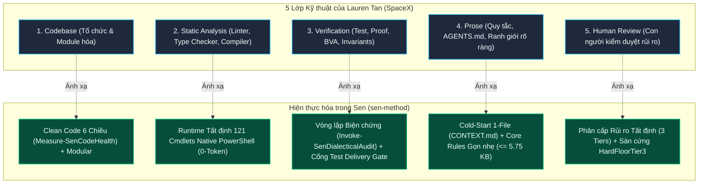

# TỔNG KẾT & ĐỐI CHIẾU CHIẾN LƯỢC: 5 LỚP KỸ THUẬT PHẦN MỀM (LAUREN TAN) VỚI HỆ ĐIỀU HÀNH SEN (`sen-method`)

> *"Bạn không cần một Software Factory. Thứ bạn cần là kỹ thuật phần mềm tốt và biết sử dụng token AI đúng chỗ."*  
> — **Lauren Tan** (@poteto), cựu kỹ sư SpaceX, Grok.

Tài liệu này tổng hợp giá trị tham chiếu từ bài học của Lauren Tan và phân tích chi tiết cách kiến trúc của **Sen (`sen-method`)** hiện thực hóa trọn vẹn 5 lớp kỹ thuật phần mềm cơ bản, giải quyết triệt để vấn đề "Agentic Bloatware / Hype" trong kỷ nguyên AI Coding.

---

## 1. Bối cảnh & Vấn đề Cốt lõi của AI Coding Hiện nay

| Vấn đề thực tế (The Trap) | Hệ quả |
| :--- | :--- |
| **Hype "Software Factory"** | Đua nhau dựng hệ thống Multi-Agent phức tạp, hàng chục agent tự nói chuyện với nhau, chi phí token bùng nổ nhưng kết quả đầu ra không kiểm soát được. |
| **Lạm dụng AI cho việc Deterministic** | Dùng LLM đắt tiền chỉ để đọc code tìm lỗi syntax, formatting hay type mismatch — những việc mà Compiler, Linter, Type Checker làm tốt hơn với chi phí 0đ và thời gian mili-giây. |
| **Thiên kiến xác nhận & Ảo giác "Xong"** | AI sinh ra code "chạy được ở bản demo" nhưng gãy vụn ở edge case, vi phạm concurrency, lỗi logic kinh doanh hoặc bảo mật vì thiếu hệ thống Verification nghiêm ngặt. |
| **Context Rot & Thiếu chỉ dẫn** | Càng ném nhiều Agent vào một codebase lộn xộn không có quy tắc, AI càng sinh code phân mảnh và phá vỡ kiến trúc sẵn có. |

---

## 2. Đối Chiếu 5 Lớp của Lauren Tan với Trụ Cột Kỹ Thuật của Sen

### Chi tiết từng lớp:

### Lớp 1 — Codebase: Muốn AI hiểu code, code phải có tổ chức
- **Góc nhìn Lauren Tan:** AI chỉ hiệu quả khi codebase có cấu trúc module rõ ràng, phân tách ranh giới mạch lạc. Đừng mong AI thông minh sửa giùm một kiến trúc rác.
- **Cách Sen giải quyết:**
  - Quy chuẩn **Clean Code 6 Chiều** (`Measure-SenCodeHealth`): giới hạn kích thước AI-Native (`<= 800 dòng / 45 KB` cho file logic, hàm `<= 100 dòng`, lồng ghép `<= 4 tầng`).
  - Kiểm soát lặp mã nguồn và dead code để giữ codebase luôn trong "vùng đọc hiểu tối ưu" của ngữ cảnh LLM.

### Lớp 2 — Static Analysis: Đừng bắt AI làm việc của công cụ truyền thống
- **Góc nhìn Lauren Tan:** Dùng Linter, Type Checker, Compiler để bắt lỗi xác định. Không tiêu tốn token AI cho việc lặp đi lặp lại.
- **Cách Sen giải quyết:**
  - **Runtime 0-Token**: Sử dụng 121 PowerShell cmdlets nội bộ và các CLI công cụ native (`git`, `linter`, `compiler`, `PSScriptAnalyzer`, `ESLint`).
  - **Hook-level Guard** (`guard.ps1`): Chặn lệnh nguy hiểm và kiểm tra static analysis tức thì trước khi code chạm vào repo.

### Lớp 3 — Verification: Code chạy được không có nghĩa là code đúng
- **Góc nhìn Lauren Tan:** Demo chạy đẹp không đồng nghĩa với logic đúng (ví dụ: tính sai giảm giá, race condition đơn hàng). Cần Unit Test, Integration Test và kiểm chứng hành vi.
- **Cách Sen giải quyết:**
  - **Nguyên tắc số 3 của Sen**: *"Có bằng chứng mới báo xong"* (`Test-SenDeliveryGate`). Không có `ExitCode = 0` thực tế thì AI tuyệt đối không được nói hoàn thành.
  - **Phản biện 7 mũi nhọn** (`Invoke-SenDialecticalAudit`): Tự động tấn công giải pháp bằng Phản ví dụ (Counterexamples), Biên (BVA), Tương tranh (Race Condition) và STRIDE Security.

### Lớp 4 — Prose: Một file hướng dẫn tốt hơn chục AI Agent
- **Góc nhìn Lauren Tan:** Đôi khi AI thất bại chỉ vì thiếu một file `AGENTS.md` rõ ràng: ranh giới thư mục nào cấm sửa, test nào phải chạy, coding style ra sao.
- **Cách Sen giải quyết:**
  - **Luật lõi siêu tinh gọn**: `rules/AGENTS.md` được khống chế cứng dưới `5.75 KB` (<= 95 dòng) để tránh ô nhiễm context.
  - **Cold-Start 1-File**: Đầu phiên làm việc chỉ đọc duy nhất `docs/CONTEXT.md`, triệt tiêu lãng phí token nạp bừa bãi.

### Lớp 5 — Human Review: Con người kiểm duyệt rủi ro
- **Góc nhìn Lauren Tan:** Mức độ kiểm duyệt phải tương xứng với mức độ rủi ro (thanh toán, dữ liệu, bảo mật, auth). Trách nhiệm an toàn không thể khoán trắng cho AI.
- **Cách Sen giải quyết:**
  - **Phân cấp rủi ro 3 Tiers** (`Get-SenTaskRiskScore`):
    - Cấp 1: Việc nhỏ làm ngay, tự kiểm tra.
    - Cấp 2: Việc vừa trình bày giải pháp + bảng chi phí tài nguyên rồi thực thi song song.
    - Cấp 3: Sàn cứng `HardFloorTier3` (chạm DB, auth, tiền bạc, xoá dữ liệu bắt buộc phải thiết kế, chờ duyệt và có điểm khôi phục `New-SenRestorePoint`).

---

## 3. Giá trị Ứng dụng Thực tiễn cho Sen

1. **Định vị & Pitch Deck:** Đưa mô hình đối sánh 5 lớp vào `docs/SEN-SHOWCASE-PITCH.md` và `docs/sen-pitch-deck.html` để khẳng định: Sen đi theo trường phái **Software Engineering Discipline** (Kỷ luật Kỹ thuật phần mềm), trực tiếp khắc phục các nhược điểm của các trào lưu AI thiếu kiểm soát.
2. **Kỷ luật Thực thi (Execution Discipline):** Nhắc nhở người vận hành và các agent trong hệ thống Sen: *Không vội sinh subagent nếu chưa cấu hình static check và verification tests.*
