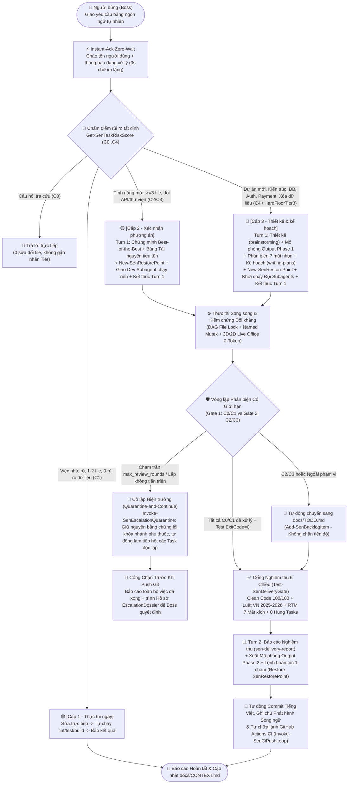
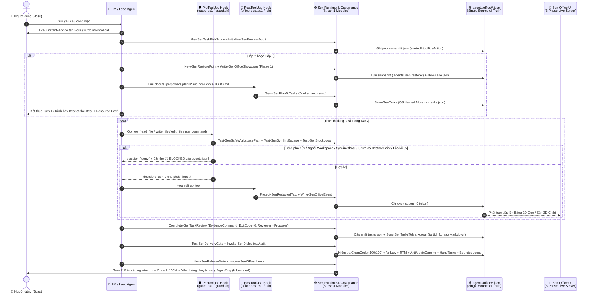
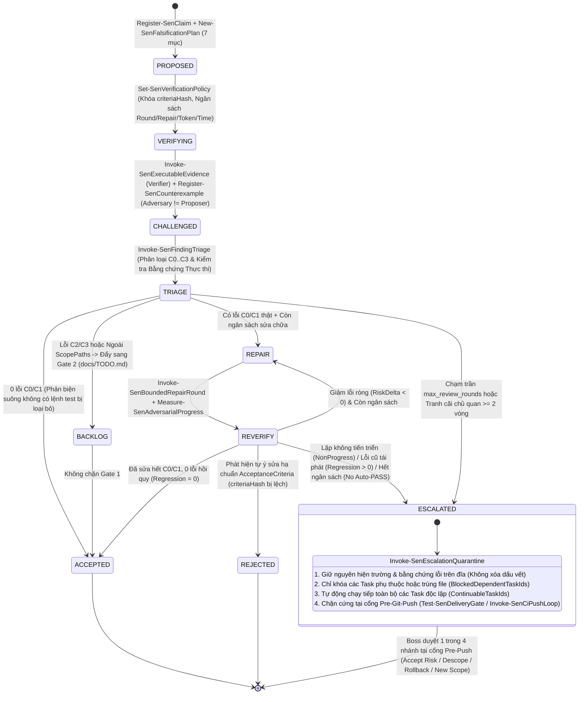

# Đặc Tả Kiến Trúc Tổng Thể, Luồng Nghiệp Vụ & Luồng Kỹ Thuật — Sen (`sen-method` `v0.5.0`)

- **Ngày ban hành:** 2026-11-08
- **Phiên bản áp dụng:** `v0.5.0` (bao gồm `Sen.Governance.psm1`, `Sen.Adversarial.psm1` `AV-01..AV-10`, và `Sen.BoundedLoop.psm1` `BVC-01..BVC-10`)
- **Trạng thái:** Đã kiểm chứng thực nghiệm (`115/115` cmdlets, `258/258` bài kiểm thử tự động, `Measure-SenCodeHealth = 100/100`, `Validate-Repo.ps1 = 0 lỗi`)
- **Tài liệu liên quan:** [`README.md`](../../../README.md) · [`CHANGELOG.md`](../../../CHANGELOG.md) · [`docs/CONTEXT.md`](../../CONTEXT.md) · [`docs/TODO.md`](../../TODO.md) · [`rules/AGENTS.md`](../../../rules/AGENTS.md)

---

## 1. Tầm Nhìn Nguyên Thủy (`v0.0`) & Sự Tiến Hóa Đến `v0.5.0`

### 1.1. Tầm nhìn nguyên thủy (`Ver 0 / v0.1.0` — 2026-11-06)
- **Khẩu hiệu cốt lõi:** *"Sen: làm việc với đội AI một cách gọn, rõ, nhẹ."* / *"Calm, clear AI work."*
- **Mục đích nguyên thủy:**
  1. **Đúng mức kiểm soát (Right-Sized Control):** Việc nhỏ tự chạy ngay (`Cấp 1`), việc vừa xác nhận phương án ngắn gọn (`Cấp 2`), việc lớn/rủi ro cao có thiết kế và kế hoạch bài bản (`Cấp 3`).
  2. **Giao diện con người tối giản (Human-First Simplicity):** Người dùng (kể cả người mới chưa từng dùng AI IDE) chỉ cần giao việc bằng ngôn ngữ tự nhiên tiếng Việt hoặc tiếng Anh, không phải nhớ lệnh kỹ thuật.
  3. **An toàn mặc định (Safety Shield):** Không bao giờ để AI tự ý xóa ổ đĩa, xóa cơ sở dữ liệu hay `git push --force` khi bật chế độ tự động.
  4. **Trực quan hóa minh bạch (Visual Transparency):** Quan sát đội ngũ AI làm việc như nhìn qua camera văn phòng (`sen-office`) kèm đối chiếu đầu ra dự kiến và thực tế.
  5. **Tiết kiệm Token (Token Economy):** Luật lõi luôn bật siêu nhỏ (`<= 5.75 KB`, `< 95 dòng`), khởi động phiên chỉ đọc 1 file (`docs/CONTEXT.md`), ghi nhận telemetry bằng Hook `0 token`.

### 1.2. Kiến trúc 2 Tầng ("Bề Mặt Tối Giản — Động Cơ Tất Định Ngầm") ở `v0.5.0`
Qua thực tiễn triển khai các dự án thực chiến (`MemoReel`, `OmniHub`, `@ll25usBot`, và tự nâng cấp chính `Sen`), một chân lý kỹ thuật đã lộ rõ: **Nếu chỉ dùng lời nhắc văn bản (Prompt/Markdown Rules), AI sẽ liên tục mắc bệnh "quên quy trình", "tự khen phương án của mình", "báo cáo xong giả tạo", hoặc "rơi vào vòng lặp tranh luận vô tận".**

Vì vậy, `Sen v0.5.0` tách kiến trúc thành **2 tầng độc lập (Dual-Layer Architecture)**:
- **Tầng Nổi (User Surface — Giữ nguyên 100% sự gọn, rõ, nhẹ của `v0.1.0`):** Người dùng vẫn chỉ nói chuyện tự nhiên, nhận phản hồi tức thì (`Instant-Ack`), đọc bảng phương án *Best-of-the-Best* + **Tài nguyên tiêu tốn** ở Turn 1 và nhận kết quả nghiệm thu ở Turn 2.
- **Tầng Chìm (Deterministic Engine Under the Hood — `8` mô-đun PowerShell, `115` cmdlets, Hooks `0-token`):** Tự động khóa an toàn đường dẫn/lệnh hủy diệt, đồng bộ 2 chiều Markdown ↔ `tasks.json`, kiểm chứng đối kháng 4 vai trò (`AV-01..AV-10`), khống chế vòng lặp phản biện có trần dừng (`BVC-01..BVC-10`), cô lập điểm nghẽn (`Quarantine-and-Continue`), phát hiện chuỗi hành động lặp lại liên phiên & đóng gói kép `SKILL.md` + script `0-token` (`Register-SenActionPattern`, `New-SenCapturedSkill, Invoke-SenPostCodePipeline`), niêm phong trạng thái SHA-256 (`Sync-SenOfficeState`), cổng Git Hook vật lý (`Install-SenGitHooks`), và tự chữa lành CI từ xa (`Invoke-SenCiPushLoop`).

---

## 2. Luồng Nghiệp Vụ Toàn Trình (End-to-End Business Flow)

Sơ đồ dưới đây mô tả trải nghiệm từ góc nhìn của **Người dùng (Boss)** và sự phối hợp của **Đội ngũ AI** từ lúc giao bài toán đến khi nghiệm thu bàn giao:

---

## 3. Luồng Hệ Thống Kỹ Thuật & Kiến Trúc Hook / Gate (Technical System Workflow)

Sơ đồ dưới đây thể hiện cách các Hook cấp hệ thống (`PreToolUse` / `PostToolUse`), 8 mô-đun PowerShell và các tệp trạng thái JSON trong `.agents/office/` phối hợp tất định ở tầng dưới:

---

## 4. Máy Trạng Thái Kiểm Chứng Đối Kháng & Cô Lập Điểm Nghẽn (`AV-01..AV-10` & `BVC-01..BVC-10`)

Để giải quyết triệt để 2 cực đoan: **(1) AI tự khen / tự duyệt giả tạo** và **(2) AI sa lầy vào vòng lặp phản biện — sửa lỗi vô tận**, `Sen.Adversarial.psm1` và `Sen.BoundedLoop.psm1` thực thi máy trạng thái hữu hạn 11 trạng thái kèm cơ chế **Cô lập và Tiếp tục (`Quarantine-and-Continue`)**:

---

## 5. Ma Trận Kiến Trúc 8 Mô-đun PowerShell & `115` Cmdlets (`v0.5.0`)

Toàn bộ phần lõi thực thi của Sen được chia thành **8 mô-đun `.psm1` chuẩn ASCII** (mỗi file đều tuân thủ nghiêm ngặt trần `AI-Native <= 800 dòng / 45 KB`, đạt điểm `Measure-SenCodeHealth = 100/100`):

| STT | Mô-đun (`scripts/*.psm1`) | Số hàm (`Cmdlets`) | Trách nhiệm cốt lõi & Các hàm tiêu biểu |
|---|---|---|---|
| 1 | `Sen.psm1` | **7** *(+1 re-export)* | Khởi tạo Workspace, dò tìm ổ đĩa trống, quản lý danh mục công cụ (`tools.json`) và nạp chuỗi mô-đun (`Get-SenDriveCandidates`, `New-SenWorkspace`, `New-SenFileFromTemplate`, `Get-SenToolCatalog`, `Get-SenToolStatus`, `Get-SenInstallPlan`, `Get-SenSelfPayloadNames`). |
| 2 | `Sen.Runtime.psm1` | **15** | Ghi/đọc JSON nguyên tử, che mật khẩu/API key (`Protect-SenRedactedText`), điều khiển sự kiện Văn phòng 3D/2D (`Write-SenOfficeEvent`, `Write-SenOfficeShowcase`), cầu chì chống lặp lỗi 3 lần (`Test-SenStuckLoop`), đọc hạn mức IDE (`Get-SenAntigravityQuota`), chấm điểm rủi ro tất định (`Get-SenTaskRiskScore` với `ComplexityLevel C0..C4` & `ExpressMode`), và kiểm định Clean Code 6 chiều (`Measure-SenCodeHealth`). |
| 3 | `Sen.Orchestrator.psm1` | **17** | Quản lý vòng đời Task DAG & khóa file `allowedPaths` (`Save-SenTasks` có khóa `Named Mutex` liên tiến trình, `New-SenTask`, `Start-SenTask`, `Unlock-SenTask`, `Complete-SenTaskReview`), giám sát & thu dọn tiến trình treo 3 tín hiệu (`Test-SenHungTasks`, `Clear-SenHungTasks` kèm quét `Win32_Process` & POSIX `ps`), cổng nghiệm thu tổng (`Test-SenDeliveryGate` có `-EnforcePhysicalDiff` & `RemediationCommands`), điểm khôi phục nhanh (`New-SenRestorePoint`, `Restore-SenRestorePoint`), chỉ số chất lượng (`Get-SenQualityMetrics`) và Backlog (`Add-SenBacklogItem`). |
| 4 | `Sen.Harness.psm1` | **17** | Cầu nối đa nền tảng 6+ IDE/CLI (`Get-SenSupportedHarnesses`, `Install-SenHarness`, `Uninstall-SenHarness`, `Test-SenHarnessStatus`, `ConvertFrom-SenHookPayload`), cài đặt Git Hook vật lý (`Install-SenGitHooks`), đồng bộ 2 chiều 0-token Markdown ↔ DAG (`Sync-SenPlanToTasks`, `Sync-SenTasksToMarkdown`), kiểm toán quy trình 12 bước (`Initialize-SenProcessAudit`, `Test-SenStageGate`, `Test-SenProjectCompliance`), vòng lặp tự chữa lành CI từ xa (`Get-SenRemoteCiStatus`, `Invoke-SenCiPushLoop`) và khóa đẳng cấu 6 tầng (`Test-SenCapabilityParity`). |
| 5 | `Sen.Governance.psm1` | **21** | Ma trận truy vết yêu cầu 7 mắt xích (`Register-SenRequirement` tự động gắn cờ `NEEDS_CLARIFICATION` khi tiêu đề có `TODO/TBD/???`, `Get-SenRequirementTraceability`), xác thực bằng chứng sống (`Register-SenEvidence` kèm băm `SHA-256` & `TTLMinutes`, `Test-SenEvidenceValidity`), đồng bộ tự chữa lành & niêm phong trạng thái SHA-256 (`Sync-SenOfficeState`), máy trạng thái Task bất biến (`Invoke-SenTaskTransition`), phân tích tác động thay đổi DAG (`Invoke-SenChangeImpactAnalysis`), phục hồi sau crash (`Invoke-SenCheckpointResume`), chống thoát Symlink & bảo vệ đường dẫn nhạy cảm (`Resolve-SenWorkspaceRoot`, `Test-SenSafeWorkspacePath`), chống xóa assertion (`Test-SenSuiteIntegrity`), nâng cấp độ giữa chừng (`Test-SenMidTaskEscalation`), dự toán token (`Measure-SenTokenEstimate`), chuyển đổi phiên bản `core`/`full` (`Set-SenEdition`), ghi chú phát hành song ngữ (`New-SenReleaseNote`, `Test-SenReleaseNoteGate`), mục bảo lưu (`Get-SenDeferredItems`), bộ nhớ bài học (`Add-SenExecutionLesson`, `Get-SenExecutionLessons` hỗ trợ lọc `-Stack` & `expiresAt`, `Get-SenMemorySnapshot`) và gỡ cài đặt (`Uninstall-SenSelf`). |
| 6 | `Sen.Adversarial.psm1` | **14** | Động cơ kiểm chứng đối kháng 4 vai trò (`AV-01..AV-10`): băm SHA-256 (`Get-SenFileSha256`, `Get-SenTextSha256`, `Get-SenCodeRevisionSnapshot`), Kế hoạch làm sai 7 phần (`New-SenFalsificationPlan`, `Test-SenFalsificationPlan`), đăng ký Claim & thực thi bằng chứng/phản ví dụ (`Register-SenClaim`, `Invoke-SenExecutableEvidence`, `Register-SenCounterexample`), gói đánh giá mù (`Get-SenBlindReviewPackage`), phán quyết độc lập 4 trạng thái (`Invoke-SenIndependentVerdict`), khóa chống gian lận chỉ số (`Lock-SenQualityBaseline`, `Test-SenAntiMetricGaming`), kiểm thử âm (`Invoke-SenGovernanceNegativeTest`) và kiểm toán biện chứng 6 vector (`Invoke-SenDialecticalAudit`). |
| 7 | `Sen.BoundedLoop.psm1` | **9** | Động cơ khống chế vòng lặp phản biện có giới hạn (`BVC-01..BVC-10`) & tự động đóng gói kỹ năng: khởi tạo chính sách & ngân sách (`Set-SenVerificationPolicy`), phân loại lỗi `C0..C3` & tách Gate 1 / Gate 2 (`Invoke-SenFindingTriage`), đo tiến triển ròng & phát hiện hồi quy (`Measure-SenAdversarialProgress`), vòng sửa chữa có trần (`Invoke-SenBoundedRepairRound`), hồ sơ leo thang (`New-SenEscalationDossier`), cô lập hiện trường & chạy tiếp việc độc lập (`Invoke-SenEscalationQuarantine`), 8 kịch bản kiểm chứng (`Invoke-SenBoundedVerificationScenarios`), phát hiện chuỗi hành động lặp lại liên phiên (`Register-SenActionPattern`) và đóng gói kép `SKILL.md` + script `0-token` (`New-SenCapturedSkill, Invoke-SenPostCodePipeline`). |
| 8 | `Sen.Packages.psm1` & `Sen.Legal.psm1` | **13 + 1** | Quản lý cài đặt, khóa commit (`sen.lock.json`), kiểm tra cập nhật định kỳ 0-token, sao lưu nguyên tử & hoàn tác gói (`Install-SenPackage`, `Update-SenPackages`, `Restore-SenPackage`, `Install-SenCreativePack` với Git Sparse-Checkout), cùng bộ quét tuân thủ pháp lý Việt Nam 2025–2026 (`Invoke-SenVnLawScan` trả về 3 trạng thái `PASS / FAIL / UNKNOWN` kèm `LegalDisclaimer`). |

---

## 6. Hệ Sinh Thái 10 Kỹ Năng (`sen-*`) & Cầu Nối Đa Nền Tảng

1. **`sen-setup`**: Trình cài đặt 9 bước có bản đồ lộ trình trực quan và chế độ cài nhanh 1 bước (`Express 1-Step Mode`).
2. **`sen-onboarding`**: Hướng dẫn tương tác cho người mới bắt đầu và chạy bài tập thực hành Cấp 1 đầu tiên.
3. **`sen-environment`**: Dò tìm sâu công cụ phát triển (`PATH`, `extraPaths`, `nvm`, `fnm`, `pyenv`) và cài đặt qua 1 bảng chọn duy nhất (`winget`/`brew`).
4. **`sen-office`**: Điều khiển Văn phòng 3D/2D hoạt động theo **3 pha tự động** (*Pha 1: Demo khi rảnh* $\rightarrow$ *Pha 2: 2D Live Gọn 100% dữ liệu thật khi đang chạy việc* $\rightarrow$ *Pha 3: Ngủ đông Hibernated khi xong việc*).
5. **`sen-clean-code`**: Kiểm định và tái cấu trúc mã nguồn theo 6 tiêu chuẩn công nghiệp (`ISO/IEC 5055`, `SonarQube`, `PSScriptAnalyzer/ESLint`, `AI-Native 800L/45KB`).
6. **`sen-vn-law`**: Kiểm toán tuân thủ pháp luật Việt Nam (`Luật 91/2025/QH15`, `NĐ 356/2025/NĐ-CP`, `Luật TMĐT 122/2025/QH15`, `Luật AI 134/2025/QH15`).
7. **`sen-delivery-report`**: Sinh báo cáo nghiệm thu có bằng chứng thực thi và đồng bộ điểm lưu `docs/CONTEXT.md`.
8. **`sen-release-readiness`**: Kiểm toán song song 8 lĩnh vực trước khi phát hành sản phẩm ra thị trường.
9. **`sen-skill-capture`**: Đóng gói các quy trình lặp lại 2–3 lần thành kỹ năng tái sử dụng trong workspace.
10. **`sen-update`**: Kiểm tra cập nhật định kỳ 0-token và nâng cấp an toàn có sao lưu hoàn tác nguyên tử.

---

## 7. Đóng Kín 4 Khoảng Trống Thực Thi (`GAP-01` .. `GAP-04`)

| Mã GAP | Phát hiện kỹ thuật | Cơ chế đóng kín tất định trong mã nguồn |
|---|---|---|
| **`GAP-01`** | Các nguyên hàm đối kháng & vòng lặp có trần (`Sen.Adversarial.psm1`, `Sen.BoundedLoop.psm1`) cần được đấu nối trực tiếp vào danh mục quy trình 12 bước (`scripts/process-manifest.json`) và luật lõi (`rules/AGENTS.md`). | Cập nhật `S2-EXPERT-COST`, `S3-TDD-VERIFY`, `S4-CONTEXT-REPORT` trong `scripts/process-manifest.json` và `rules/AGENTS.md` (`<= 5.75 KB`) để neo cứng `Invoke-SenDialecticalAudit`, `Invoke-SenBoundedRepairRound`, `Invoke-SenEscalationQuarantine`, `Sync-SenOfficeState` và `Install-SenGitHooks`. |
| **`GAP-02`** | `Register-SenEvidence` chỉ kiểm tra `LastWriteTimeUtc`, chưa băm nội dung `SHA-256` của tệp đích và chưa có thời hạn `TTL` tự động hết hạn. | Bổ sung `-SubjectPath` và `-TTLMinutes` (mặc định `1440` phút) vào `Register-SenEvidence`, tính `subjectHash` (`SHA-256`) và `expiresAt`. `Test-SenEvidenceValidity` kiểm tra đủ 3 điều kiện vật lý: `TTL_EXPIRED`, `SHA256_MISMATCH` và `MODIFIED_AFTER_EVIDENCE`. |
| **`GAP-03`** | `Get-SenExecutionLessons` trả về toàn bộ bài học mà chưa tự động lọc bỏ các bài học đã hết hạn (`expiresAt`) hoặc lọc theo ngăn xếp công nghệ (`-Stack`). | Bổ sung tham số `-Stack` và `-IncludeExpired` vào `Get-SenExecutionLessons`; mặc định loại bỏ các bản ghi có `expiresAt < UtcNow` và chỉ trả về bài học khớp `stack -eq 'all'` hoặc `-Stack`. |
| **`GAP-04`** | `Register-SenRequirement` chưa tự động phát hiện tiêu đề chứa `TODO / TBD / ???`; `Test-SenHungTasks` mới chỉ quét tiến trình mồ côi qua `Win32_Process` trên Windows. | `Register-SenRequirement` tự động chuyển `Status = 'NEEDS_CLARIFICATION'` khi tiêu đề khớp `(?i)\b(TODO\|TBD)\b\|\?\?\?`. `Test-SenHungTasks` bổ sung nhánh POSIX (`ps -eo pid,etimes,args`) trên macOS/Linux để phát hiện tiến trình treo vượt ngưỡng. |

---

## 8. Red-Team Critique of the Swiss Watch Metaphor & The Zero-Trust Physical Gate Architecture

Một cỗ máy cơ khí Thụy Sĩ giả định các bánh răng bằng thép không thể tự ý nhảy cóc. Ngược lại, trong hệ thống Agentic AI, tác nhân thực thi (LLM) là một thực thể xác suất: nếu các bánh răng chỉ được nối bằng lời nhắc văn bản hoặc các lệnh gọi tùy chọn, LLM có thể bỏ qua hoặc làm giả trạng thái. Dưới đây là **6 mũi tấn công Red-Team** vào ẩn dụ "Đồng hồ Thụy Sĩ" và **Kiến trúc Cổng Vật Lý Zero-Trust (Option C)** đã được triển khai để vô hiệu hóa từng mũi tấn công:

| Mũi tấn công Red-Team | Bản chất lỗ hổng (Khi chỉ dựa vào quy ước) | Phòng tuyến Vật lý Zero-Trust (Đã triển khai thực tế) |
|---|---|---|
| **Attack 1: Bỏ qua không gọi hàm (`The Uncalled Cmdlet Bypass`)** | Nếu `rules/AGENTS.md` chỉ dặn bằng lời, LLM có thể sửa code rồi báo "Xong" hoặc chạy `git commit` mà không gọi các cmdlet kiểm chứng. | **Cổng Git Hook Vật lý (`Install-SenGitHooks`) + Hook `PreToolUse` (`guard.ps1`):** Cài đặt trực tiếp `.git/hooks/pre-commit` và `.git/hooks/pre-push` gọi `Test-SenDeliveryGate`. Mọi thao tác commit/push đều bị hệ điều hành chặn cứng (`exit 1`) nếu cổng nghiệm thu chưa đạt `Passed = $true`. |
| **Attack 2: Ngụy tạo cùng chung ngữ cảnh (`Same-Brain Collusion`)** | Nếu Builder, Verifier, Critic và Judge dùng chung một suy luận mà không có đầu vào vật lý độc lập, LLM sẽ tự viết bài kiểm thử dễ dãi để tự chấm `ACCEPTED`. | **Kiểm định Diff & Hash Vật lý trên Đĩa (`Test-SenEvidenceValidity`, `Test-SenAntiMetricGaming`, `Get-SenBlindReviewPackage`):** Bằng chứng bắt buộc gắn với mã băm `SHA-256` của tệp thực tế trên đĩa (`subjectHash`), mã thoát tiến trình `ExitCode = 0`, và gói đánh giá mù tước bỏ toàn bộ lý lẽ bào chữa của tác giả. |
| **Attack 3: Phình đại mã nguồn & Đốt Token để lách cổng (`Framework Bloat & Token Tax`)** | Khi bị một cổng kiểm tra chặn lại với thông báo lỗi mơ hồ, LLM thường đọc toàn bộ mã nguồn `.psm1` để tìm cách "chiều lòng" hoặc lách điều kiện kiểm tra. | **Hướng dẫn Sửa lỗi 1 Dòng Tất định (`RemediationCommand` / `RemediationCommands`):** Cả `Test-SenDeliveryGate` và `Sync-SenOfficeState` luôn trả về mảng `RemediationCommands` chỉ rõ câu lệnh PowerShell 1 dòng cần chạy để khắc phục, giúp LLM sửa đúng đích mà không cần đọc mã nguồn framework. |
| **Attack 4: Trạng thái Ma / Rác Tích tụ (`Zombie State Drift`)** | Qua nhiều phiên làm việc, `.agents/office/*.json` tích tụ bài học hết hạn, bằng chứng cũ của code đã sửa, hoặc khóa Task mồ côi gây tắc nghẽn giả. | **Bộ Đồng bộ Tự chữa lành (`Sync-SenOfficeState -PruneStale`):** Tự động cắt tỉa bài học hết hạn trong `lessons.json` / `execution-memory.json`, đánh dấu `STALE` cho bằng chứng lệch `SHA-256` hoặc quá hạn `TTL`, và giải phóng khóa Task quá hạn (`Invoke-SenCheckpointResume`). |
| **Attack 5: Giả mạo trực tiếp tệp JSON trạng thái (`Direct JSON State Forgery`)** | Thay vì chạy quy trình kiểm chứng, một tác nhân hoặc script bên ngoài có thể ghi đè trực tiếp `"status": "done"` hoặc `"Passed": true` vào `.agents/office/*.json`. | **Dấu Niêm phong Tổ hợp SHA-256 (`Sync-SenOfficeState -UpdateSeal / -VerifySeal`):** Tính toán mã băm SHA-256 cho từng tệp `.agents/office/*.json` và mã băm tổ hợp `compositeHash` lưu tại `state-seal.json`. `Test-SenDeliveryGate` tự động đối chiếu dấu niêm phong và chặn ngay nếu phát hiện bất kỳ tệp trạng thái nào bị sửa ngoài luồng (`Tampered = $true`). |
| **Attack 6: Ảo tưởng Ngữ nghĩa từ Kiểm tra Cú pháp (`Regex Theatre vs Semantic Reality`)** | Quét biểu thức chính quy (Regex) hoặc đếm dòng không thể tự động hiểu hết logic nghiệp vụ phức tạp hoặc tính hợp lệ pháp lý thực tế. | **Phân tách Ranh giới Tất định vs. Biện chứng (`PASS / FAIL / UNKNOWN` + `Invoke-SenDialecticalAudit`):** Các phép đo vật lý (SHA-256, AST, ExitCode, kích thước tệp) được khóa cứng bằng code; các câu hỏi ngữ nghĩa/pháp lý trả về `UNKNOWN` kèm yêu cầu kiểm chứng đối kháng 6 vector và xác nhận của con người. |

