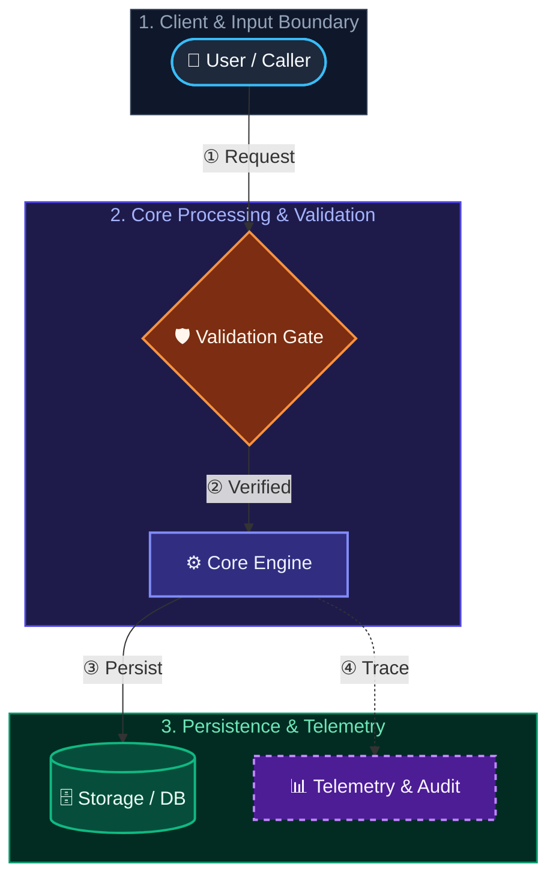

# `sen-office` — 3D Chibi AI Office & Dual-Phase Output Visualizer

## Overview
`sen-office` is bundled directly inside Sen (`v0.2.0+`). It gives the user a real-time 3D isometric command center showing all 9 AI roles (Boss, PM/Tech Lead, BA/Architect, Scout 1, Scout 2, Dev FE, Dev BE, Tester/QA, Security, Legal), a live walkie-talkie feed with system-verified evidence badges (`✓ Hook`), a 6-counter Inspector Drawer, a 2D Compact Table, a Replay Timeline Scrubber, and a **Dual-Phase Domain Output Visualizer** comparing **Phase 1 (Post-Design & Plan Blueprint)** against **Phase 2 (Post-Delivery Verified Outputs & Quality Gates)**.

## When to Trigger
- **Open the 3D Office:** `"mở văn phòng"`, `"mở văn phòng 3D"`, `"open office"`, `"show 3D office"`.
- **Switch Camera / Token Modes:**
  - `"tắt văn phòng"` / `"turn off office"` -> `mode = "off"` (0 tokens, 0 hook writes).
  - `"chế độ tiết kiệm"` / `"eco mode"` -> `mode = "eco"` (default, 0 extra LLM tokens; uses `PreToolUse` and `PostToolUse` hooks only).
  - `"chế độ chi tiết"` / `"full mode"` -> `mode = "full"` (adds natural-language AI explanations alongside hook telemetry; warn user once about ~3–8% extra token usage before switching).
- **Automatic Lifecycle Updates:**
  - **At the start of Turn 1 for Tier 2 / Tier 3 tasks:** Inspect `Get-SenOfficeConfig` (or `process-audit.json` -> `officeAction`). If `mode != "off"` (`officeAction == "auto_start"`), automatically launch `scripts/start-office.ps1` as a background daemon (if not already running) and display the live 3D Office URL (`http://127.0.0.1:47890`) in Turn 1 so the user can watch subagents work in real time. If `mode == "off"` (`officeAction == "offer_enable"`), add a 1-line offer in Turn 1 asking if the user wants to open the 3D AI Office.
  - At the end of **Tier 3 Design & Plan** (`brainstorming` + `writing-plans`), update Phase 1 of `.agents/office/showcase.json` via `Write-SenOfficeShowcase`.
  - At the end of **Tier 2 / Tier 3 Delivery Report** (`sen-delivery-report`), update Phase 2 of `.agents/office/showcase.json` via `Write-SenOfficeShowcase`.

---

## Step-by-Step Workflows

### 1. Opening the 3D Office (`"mở văn phòng"` / `"open office"`)
1. Import `<WORKSPACE>/.agents/plugins/sen-method/scripts/Sen.psm1` (or `./scripts/Sen.psm1` when working inside the Sen repo).
2. Ensure the office mode is active (`eco` by default if currently `off`):
   ```powershell
   Import-Module "<WORKSPACE>/.agents/plugins/sen-method/scripts/Sen.psm1" -Force
   $cfg = Get-SenOfficeConfig -Workspace "<WORKSPACE>"
   if ($cfg.mode -eq "off") {
       Set-SenOfficeConfig -Workspace "<WORKSPACE>" -Mode "eco" | Out-Null
   }
   ```
3. Launch the zero-dependency Local Office Server (`scripts/start-office.ps1` on Windows, `scripts/start-office.sh` on macOS/Linux) as a background daemon (`IsDaemon = $true`), or open `office/index.html` directly if the user only wants static Demo Mode:
   ```powershell
   powershell -NoProfile -ExecutionPolicy Bypass -File "<WORKSPACE>/.agents/plugins/sen-method/scripts/start-office.ps1" -Workspace "<WORKSPACE>"
   ```
4. Report the live URL (`http://127.0.0.1:47890`) and remind the user they can switch between **🏢 Sàn 3D**, **📋 2D Gọn**, **🎯 Đầu ra 2 Giai đoạn**, and **🔀 Chia đôi**, toggle **🔒 Ẩn nhạy cảm** (Streamer Mode) or **🌙 Đêm**, and click any Chibi character or room zone to inspect its 6 live counters.

---

### 2. Switching Modes (`off` | `eco` | `full`)
- **To `off` (`"tắt văn phòng"`):**
  ```powershell
  Set-SenOfficeConfig -Workspace "<WORKSPACE>" -Mode "off"
  ```
  Confirm that the camera and `PostToolUse` telemetry hook are now paused (`0 token`).
- **To `eco` (`"chế độ tiết kiệm"`):**
  ```powershell
  Set-SenOfficeConfig -Workspace "<WORKSPACE>" -Mode "eco"
  ```
  Confirm that `sen-office` is recording system-verified tool and subagent activity with **0 extra LLM tokens**.
- **To `full` (`"chế độ chi tiết"`):**
  1. Warn the user in one sentence that `"full"` mode adds natural-language agent explanations (~3–8% extra token usage) and ask once to confirm (unless the user already said `"bật luôn chế độ chi tiết"`).
  2. Run:
     ```powershell
     Set-SenOfficeConfig -Workspace "<WORKSPACE>" -Mode "full"
     ```
  3. While `mode == "full"`, at major subagent handoffs or milestones, call `Write-SenOfficeEvent` with `-Source "ai-full"` and a concise explanation in `-FullText`.

---

### 3. Updating Dual-Phase Showcase (`Write-SenOfficeShowcase`)
When `Get-SenOfficeConfig` has `mode != "off"`:
- **After Tier 3 Design & Plan (Phase 1):**
  Call `Write-SenOfficeShowcase` with `projectTitle`, `domain` (`"web-ui"`, `"backend-api"`, `"cli-library"`, `"mobile-game"`, `"docs-research"`), `tier`, and `phase1` (`summary`, `specPath`, `planPath`, `expectedOutputs`).
- **Before presenting `sen-delivery-report` (Phase 2):**
  Call `Write-SenOfficeShowcase` updating `phase2` (`summary`, `verifiedOutputs`, and `gates` for `tests`, `build`, `security`, and `legal` set to `"PASS"`, `"WARN"`, or `"BLOCK"`).

---

### 4. Semantic Layered Mermaid Pro & Archify Standard (Rule 8)
Whenever rendering inline Mermaid diagrams in chat, specs, plans, or READMEs, **never** output flat unstyled `flowchart` blocks or `<br/>` HTML tags. Always apply the Sen Semantic Layered Palette:



For interactive standalone HTML/SVG diagrams (with Pan/Zoom, Dark/Light theme, Path Tracing, and Before/After Architecture Diff), use `.agents/skills/archify/SKILL.md` or `generative_ui`.

