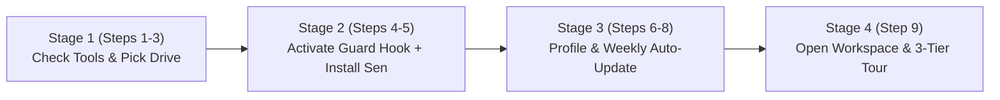

# `sen-setup` — Interactive Sen Workspace Setup

## Language & Interaction Rules
- Always communicate with the user in the language they use (Vietnamese if they write in Vietnamese, English otherwise).
- Never overwrite or delete existing user files without explicit permission.
- Let `<SEN_REPO>` be the root directory of this `sen-method` copy (either the temporary directory downloaded via `INSTALL.md` or `<workspace>/.agents/plugins/sen-method`).

---

## Step 0: Show Visual Setup Roadmap & Permission Preview First
Before running any installation command, **always display a short 4-stage visual roadmap** in the user's language so beginners (even on a brand-new Antigravity IDE with zero pre-granted permissions) know exactly what will happen, when the Safety Shield is activated, and why the IDE asks them to click **Run / Allow**:



- **Explain IDE permission prompts in 2 lines:** On a fresh Antigravity install, the IDE shows a **Run / Allow** button before each PowerShell/Bash command; simply click **Allow** when prompted.
- **Highlight when the Safety Shield turns on:** In **Stage 2 (Step 4)**, Sen installs a **2-layer Safety Shield** (`hooks.json` + `scripts/guard.ps1`/`guard.sh` blocking `git push --force`, `git reset --hard`, and recursive deletes `rm -rf` / `Remove-Item -Recurse`, plus `.agents/rules/safety.md`).
- **Express 1-Step Mode (`"cài nhanh"` / `"express setup"`):** Offer **Express Mode** (uses the top recommended drive `<Drive>:\Sen-Workspace`, installs required packages at pinned commits, sets `Standard` project scale) or **Guided 9-Step Mode** (below).

---

## The 9-Step Setup Flow

### Step 1: Check `git` and `node` (`Get-SenToolStatus`)
1. Import the Sen PowerShell module (on Windows):
   ```powershell
   Import-Module -Name "<SEN_REPO>/scripts/Sen.psm1" -Force
   $gitStatus  = Get-SenToolStatus -Id "git"
   $nodeStatus = Get-SenToolStatus -Id "node"
   ```
   *(On macOS/Linux without PowerShell, check `command -v git` and `command -v node`.)*
2. **`git` (Required):**
   - If `$gitStatus.Status` is `missing` or `outdated`, explain that Git is required to fetch Sen's companion packages (`superpowers`, `security-audit`) and offer to install it via `sen-environment` using official package managers (`winget install --id Git.Git -e --source winget` on Windows, or `brew install git` on macOS).
   - Always wait for explicit user confirmation before installing any system tool.
3. **`node` (Informational only):**
   - Report whether `node` was detected (`$nodeStatus.Status` / `$nodeStatus.Version`).
   - Explicitly note that **Node.js is only needed for the virtual office monitor (`sen-office`), and is NOT required for core Sen**. Do not block setup if `node` is missing.

---

### Step 2: Select Workspace Drive and Folder (`Get-SenDriveCandidates`)
1. On Windows, query writable drives with `> 1 GB` free space sorted by free space descending:
   ```powershell
   Import-Module -Name "<SEN_REPO>/scripts/Sen.psm1" -Force
   $drives = @(Get-SenDriveCandidates)
   $drives | Format-Table Root, FreeGB, Writable -AutoSize
   ```
2. Present the drive list with free space (`FreeGB`) to the user and recommend the first candidate (`$drives[0].Root`, which has the most free space):
   - Default proposed workspace path on Windows: `<Drive>:\Sen-Workspace` (for example, `D:\Sen-Workspace` when `D:\` is first).
   - Default proposed workspace path on macOS/Linux: `~/Sen-Workspace`.
3. Ask the user to choose one of:
   - The recommended default path (`<Drive>:\Sen-Workspace` or `~/Sen-Workspace`),
   - The folder currently open in Antigravity IDE, or
   - Another custom folder path of their choice.
4. Store the chosen full path as `<WORKSPACE>`.

---

### Step 3: Confirm Core Legal & Security Gates (`security-audit` & `vn-law-check`) & Optional Creative Packs
1. Inform the user in one sentence that Sen installs **`superpowers`**, **`security-audit`**, and **`vn-law-check`** (Vietnamese Web & Mobile App legal compliance: Luật 91/2025, NĐ 356/2025, Luật TMĐT 122/2025, Luật AI 134/2025) by default so every web/app project is protected from design to release.
2. Mention that if their work involves **Graphic Design / Store Screenshots**, **Video Editing**, or **3D Modeling**, Sen also provides 3 optional **Creative Domain Packs** (`media-image`, `media-video`, `media-3d`) powered by Git sparse-checkout (`Install-SenCreativePack -Workspace "<WORKSPACE>" -Pack @("media-image", "media-video", "media-3d")`) that they can enable anytime without bloating core setups.

---

### Step 4: Run Non-Interactive Installer (`install.ps1` / `install.sh`)
Run the non-interactive installer script, which performs Spec steps 3, 4, and 7 atomically without overwriting existing files:
- Creates workspace skeleton from `templates/workspace/`: `.agents/rules/`, `.agents/plugins/`, `.agents/skills/`, `Code/`, `Templates/`, `docs/`.
- Installs Sen into `<WORKSPACE>/.agents/plugins/sen-method/`.
- Fetches the latest shallow clones (`--depth 1`) of `superpowers` into `.agents/plugins/superpowers/`, `security-audit` into `.agents/skills/security-audit/`, and (if selected) `vn-law-check` into `.agents/skills/vn-law-check/`.
- Creates `<WORKSPACE>/.agents/rules/safety.md` from `templates/safety.template.md` with `{{WORKSPACE_ROOT}}` set to `<WORKSPACE>` (if not already present).
- Writes `<WORKSPACE>/.agents/sen.lock.json` with package repo URLs, subPaths, commits, and timestamps (only when all required packages succeed).

**Windows command:**
```powershell
# Add -WithVnLawCheck if the user opted in at Step 3
powershell -NoProfile -ExecutionPolicy Bypass -File "<SEN_REPO>/scripts/install.ps1" -Workspace "<WORKSPACE>" -SenSource "<SEN_REPO>"
```

**macOS / Linux command:**
```bash
# Add --with-vn-law-check if the user opted in at Step 3
bash "<SEN_REPO>/scripts/install.sh" --workspace "<WORKSPACE>" --sen-source "<SEN_REPO>"
```

Parse the JSON result printed on the final stdout line (`workspace`, `sen`, `packages`, `lockWritten`, `safetyCreated`).
- If the script exits non-zero or `lockWritten` is `false`, report the exact package error to the user in their language and help them resolve network/Git access before retrying.

---

### Step 5: Report Installation Summary & Project Multi-Harness Bridges (`Install-SenHarness`)
Summarize what `install.ps1` / `install.sh` did in the user's language:
- Which items were newly installed (`status: "installed"`) vs. already present and preserved untouched (`status: "exists"`).
- Whether `.agents/rules/safety.md` was newly created (`safetyCreated: true`) or kept as-is (`false`).
- Confirm that `.agents/sen.lock.json` was written with the locked commit hashes.
- Run `Install-SenHarness -Workspace "<WORKSPACE>" -Harness @("all")` so the workspace works seamlessly across **Antigravity**, **Claude Code**, **Cursor**, **GitHub Copilot**, **Windsurf**, and **Codex CLI / OpenCode**.

---

### Step 6: Configure User Profile (`profile.md`)
1. Check `<WORKSPACE>/.agents/rules/profile.md` (and `<WORKSPACE>/.agents/memory/profile.md` if present from an older setup).
2. If `<WORKSPACE>/.agents/rules/profile.md` already exists and contains no `{{...}}` template placeholders, keep it untouched and inform the user.
3. If `profile.md` is missing or still contains placeholders (`{{NAME}}`, `{{LANGUAGE}}`, `{{STACK}}`, `{{STYLE}}`), ask the user **4 profile questions** in a single friendly message:
   1. **Name / Role (`NAME`):** How should the AI address you?
   2. **Preferred language (`LANGUAGE`):** What language should the AI reply in by default (e.g., Tiếng Việt, English)?
   3. **Primary tech stack & technical level (`STACK`):** What technologies do you use most, or are you a beginner / non-programmer?
   4. **Working / communication style (`STYLE`):** How do you prefer the AI to work and explain things (e.g., concise & direct, step-by-step explanations, visual diagrams)?
4. Fill `<WORKSPACE>/.agents/rules/profile.md` using `New-SenFileFromTemplate`:
   ```powershell
   Import-Module -Name "<WORKSPACE>/.agents/plugins/sen-method/scripts/Sen.psm1" -Force
   New-SenFileFromTemplate `
       -Template "<WORKSPACE>/.agents/plugins/sen-method/templates/profile.template.md" `
       -Destination "<WORKSPACE>/.agents/rules/profile.md" `
       -Values @{
           NAME     = "<user name/role>"
           LANGUAGE = "<preferred language>"
           STACK    = "<tech stack / level>"
           STYLE    = "<working style>"
       }
   ```
   *(If `profile.md` already existed with raw `{{...}}` placeholders, replace those placeholders in-place.)*

---

### Step 7: Register Weekly Update Schedule (`register-schedule.ps1`)
Register the zero-token background update checker so the OS checks for updates at most once every 7 days and only writes `.agents/rules/sen-update-notice.md` when an update exists:
- **Windows:**
  ```powershell
  powershell -NoProfile -ExecutionPolicy Bypass -File "<WORKSPACE>/.agents/plugins/sen-method/scripts/register-schedule.ps1" -Workspace "<WORKSPACE>"
  ```
- **macOS / Linux:**
  Do not edit the user's crontab automatically. Show them the optional daily cron line they can add via `crontab -e`:
  ```cron
  0 9 * * * bash "<WORKSPACE>/.agents/plugins/sen-method/scripts/check-updates.sh" --workspace "<WORKSPACE>" >/dev/null 2>&1
  ```

---

### Step 8: Detect Duplicate Installations
Antigravity plugins and skills share a global namespace; duplicate copies cause one copy to be silently ignored.
1. Check whether `superpowers` or `security-audit` also exist in any other location that Antigravity reads:
   - `~/.gemini/config/plugins` and `~/.gemini/config/skills`
   - `~\.gemini\antigravity\plugins` and `~\.gemini\antigravity\skills` (if present)
   - Any other path inside the current workspace outside `<WORKSPACE>/.agents/plugins/superpowers` and `<WORKSPACE>/.agents/skills/security-audit`
2. If duplicates are found:
   - List the exact duplicate paths for the user.
   - Ask which copy they want to keep before performing any removal. Never delete files without explicit user confirmation.

---

### Step 9: Workspace Switch Check or Tier 1 Onboarding Handoff
Compare `<WORKSPACE>` with the folder currently open in Antigravity IDE:

- **Case A — `<WORKSPACE>` is DIFFERENT from the currently open folder:**
  Antigravity only loads `.agents/plugins/sen-method/rules/AGENTS.md` when `<WORKSPACE>` itself is the open workspace folder. Stop here and instruct the user in their language:
  - **Vietnamese:** *"Cài đặt Sen tại `<WORKSPACE>` đã hoàn tất! Hãy mở thư mục `<WORKSPACE>` bằng **File → Open Folder**, sau đó gõ `'hướng dẫn tôi'` trong cuộc trò chuyện mới để bắt đầu và chạy thử việc Cấp 1 đầu tiên."*
  - **English:** *"Sen setup at `<WORKSPACE>` is complete! Please open `<WORKSPACE>` via **File → Open Folder**, then type `'onboard me'` in a new chat to start and run your first Tier 1 check."*

- **Case B — `<WORKSPACE>` IS the currently open folder:**
  Offer to run `sen-onboarding` immediately (or execute a small Tier 1 smoke test to confirm the `[Cấp 1 - Thực thi ngay]` / `[Tier 1 - Doing it now]` label and active rules are working), and let the user know they can type `"hướng dẫn tôi"` or `"onboard me"` anytime.
